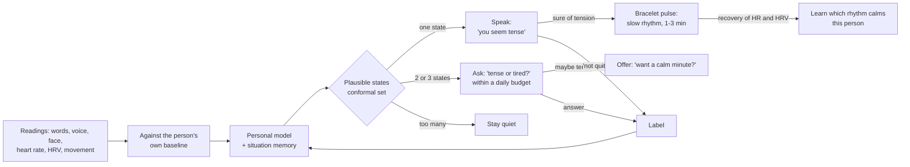
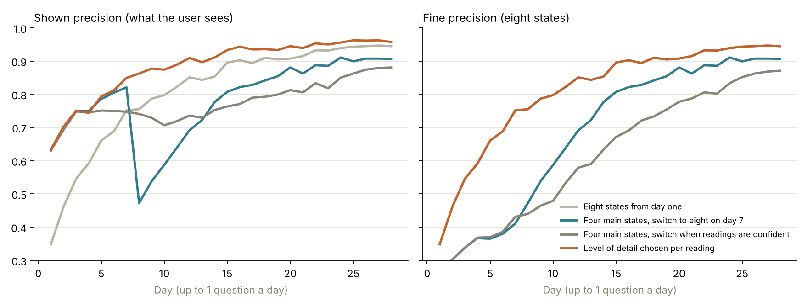
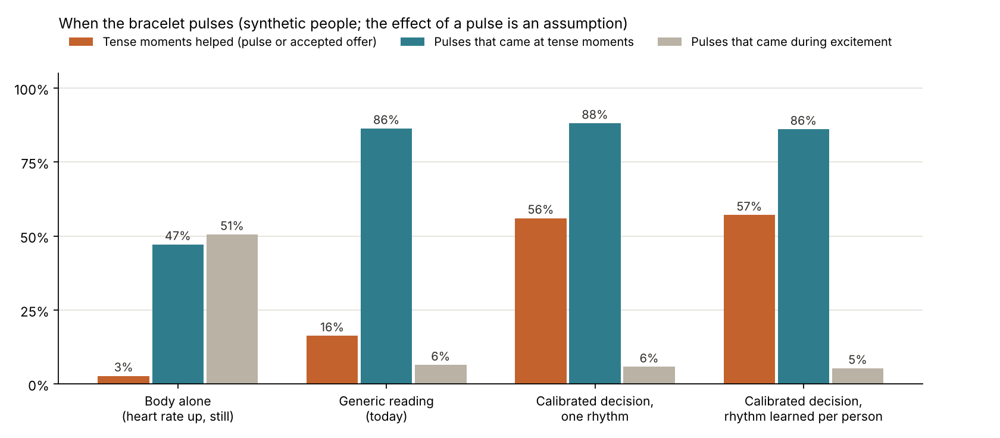

# SOUL-Calibrate

**Personal calibration, active questions and user-grounded evaluation for emotion-reading systems.**
A proposal for the SOUL layer of Nightlet, by **Emanuele De Bernardis** (November 2026).

> Emotion signals in voice, face and body are weak and highly personal in everyday life. A generic model
> cannot know when it is right for one person. SOUL-Calibrate gives every user a personal baseline and a model
> that learns from them, asks only when it is unsure, and measures everything against the user's own answers.

**In Nightlet's terms:** people want to feel understood, not optimized. SOUL-Calibrate sits on top of any SOUL
model, in-house or from a partner, and makes its reading right for this person. It decides when SOUL speaks,
asks "does this feel right?" or stays quiet, and so when the bracelet should pulse to calm. It learns on the
phone without breaking "never used for training", and measures every model against the user's own answers.

**All numbers in this repository come from synthetic people.** They show how the method behaves, not how real
users are; the first checks on real data are E31 (real voice) and E32 (the pulse) in [docs/16](docs/16-experiments.md).

## Contents

1. [How it works](#how-it-works)
2. [The problem](#1-the-problem)
3. [The solution: a closed personal loop](#2-the-solution-a-closed-personal-loop)
4. [What the simulations show](#3-what-the-simulations-show)
5. [When the bracelet pulses](#4-when-the-bracelet-pulses)
6. [Code Nightlet can run: `engine/soulcal`](#5-code-nightlet-can-run-enginesoulcal)
7. [How it is evaluated and tested](#6-how-it-is-evaluated-and-tested)
8. [What is not done yet](#7-what-is-not-done-yet)
9. [How the ideas connect: knowledge graph](#8-how-the-ideas-connect-knowledge-graph)
10. [Repository map, documents and quick start](#repository-map)

## How it works



Every answer improves the next reading of the same person and the same kind of moment. The language model
only writes the words of a reading; it never decides what the reading is.

## 1. The problem

- In the largest in-the-wild smartphone study (560 people), prosody predicted momentary valence at ρ = 0.02.
- 32.5–69.3% of the variance of voice features depends on who is speaking, not on how they feel.
- Audio-language models follow the words when the voice says otherwise.
- The body says "how much", not "which way": heart rate rises with excitement as with anxiety.
- Group-level findings often do not hold for the individual.

→ [docs/00-problem.md](docs/00-problem.md)

## 2. The solution: a closed personal loop

1. **Enrollment** (3–7 days): fixed sentences, resting physiology, two sliders and one word.
2. **Session anchor** (5 seconds): one neutral sentence + resting heart rate, so only the voice changes.
3. **Rolling personal baseline:** every signal is read against the person's own norm, with a drift trigger.
4. **Decision with a guarantee:** a conformal set of plausible states → **speak** (one state), **ask** (2–3
   states, offered as the options), or **stay quiet**.
5. **Personal head and situation memory:** each answer updates a small per-user model on the device, and every
   later reading of the same kind of moment.
6. **Support:** the bracelet pulses only when the reading is sure the person is tense.

→ [docs/01-architecture.md](docs/01-architecture.md)

## 3. What the simulations show

### First simulation: personalization and a private cohort

| Setting | Accuracy (4 states, chance 25%) |
| --- | --- |
| Today: generic model trained on public data | 0.550 |
| + answers from a private cohort of 50 users (for users never asked) | 0.590 |
| Full loop: the user also answers 20 questions | 0.652 |

A rolling baseline recovers after a step change in the signals (0.581 vs 0.541 for a fixed one), and with a
generic model Nightlet would have to ask at 76% of moments, so personalization comes before speaking and
questions need a budget. → [docs/18-simulation.md](docs/18-simulation.md)


### Recurring situations: one answer, every later reading of the same situation

6 recurring situations per person, a 7-day calibration week with at most one question a day, then 5 test days
without questions:

| Policy | Questions | Accuracy in the test days |
| --- | --- | --- |
| No questions (today) | 0 | 0.504 |
| Random moment, closed question | 7.0 | 0.751 |
| Ambiguous moment, closed question | 6.0 | **0.863** |

After one answer the same situation is read correctly 89% of the time, and the set of plausible states narrows
from 2.4 to 1.4 in a week. After the week Nightlet speaks in 72% of readings and is right 94% of the time when
it does (today: 7.5% and 82%). With a shared model trained only on public data, as Nightlet's privacy promise
requires, the gain grows as public data differ more from users. → [docs/20](docs/20-recurring-situations.md)


### How many questions? The user picks the speed

Every budget reaches about the same accuracy; more questions only get there sooner. Reaching 0.90 takes about
10–12 answers: about 3 weeks at one question every other day ("light"), 11 days at 1 a day ("standard"), 8 days
at 2 a day ("fast"). Beyond about 9 answers a week, questions stop helping, because the system only asks when it
is torn. Users choose the speed and the hours, and can leave free notes. → [docs/23](docs/23-question-budget.md)


### What "precise" means, and eight states

Every accuracy here means: the reading names the state the person would choose themselves, at that moment
(Nightlet's own definition: the user is the best source). It does not yet cover intensity, mixed states or
causes. With eight states (an intermediate state between each pair on the valence × arousal circle), the
question rule must also ask when more than three states are plausible; then eight states reach the same level
with about 50% more answers. → [docs/24](docs/24-what-precise-means.md)

### Coarse to fine: say what you know, at the level you know it

Ask about the fine states from day one, but show each reading at the level the model is sure of ("calm" before
"content"). With eight states, readings are right 0.75 of the time on day 3 and 0.85 after a week, against 0.55
and 0.75 when eight states are shown from the start, and the model learns just as fast. Switching to fine
questions only later slows learning. → [docs/25](docs/25-coarse-to-fine-and-archetypes.md)



### Learning from the cohort, and archetypes (future phase)

The goal is the path glucose monitors took, from finger-stick calibration to factory calibration: learn from
consenting users so new people need fewer questions. In a first synthetic check, a model pooled over the cohort
raises a new person's first-week accuracy by 3 to 5 points; archetypes (masks with words, flat voice, serious
face) add nothing on top of it yet, so the pooled cohort comes first. → [docs/25](docs/25-coarse-to-fine-and-archetypes.md)

### When words and face or voice disagree

The disagreement becomes a reason to ask, read against the person's own baseline: in the engine demo, questions
triggered by disagreement hit real masking 48% of the time (base rate 9%). → [docs/21](docs/21-text-face-incongruence.md)

## 4. When the bracelet pulses

The pulse is where the reading becomes help, so it follows the same rule as the reading.

| The engine | The bracelet | Why |
| --- | --- | --- |
| Sure the person is tense, against their own baseline | **Pulse:** 1–3 minutes of a slow heartbeat below their resting rate, or a breathing pacer at about 6 a minute; a line on screen; a calm voice only if the user turned it on | This is the moment it is for |
| Unsure, tense is possible | **Offer:** one soft tap, "Want a calm minute?"; the answer is also a label | An imposed pulse on a wrong reading costs trust |
| Calm, excited, low, or moving | Nothing | Excitement looks like stress to the body; exercise raises heart rate |

Gates: bracelet worn, not moving, at most 3 a day, 90 minutes apart, in the hours the user chose. 20% of eligible
moments are held out at random, so the effect is measured on the person's own recovery, and the rhythm that calms
them is learned.



In this synthetic check, **the effect of a pulse is an assumption**; what is measured is when the pulse fires.
Pulses triggered by the body alone land on excitement half the time and reach 3% of tense moments; the calibrated
decision reaches 56% with 88% of pulses at tense moments. The better the reading, the more often the pulse can
help without false alarms. → [docs/26-when-to-pulse.md](docs/26-when-to-pulse.md)

## 5. Code Nightlet can run: `engine/soulcal`

A small Python package (numpy only). It takes what the device and app already produce (facial, speech and text
model outputs; heart rate, HRV, skin temperature, movement) and returns speak / ask / quiet for every reading.
It learns from answers and one-tap corrections, flags when words and expression disagree, and keeps its state
in a JSON file on the phone.

| Module | What it does | Docs |
| --- | --- | --- |
| `engine.SoulEngine` | baseline, fusion, situation memory, conformal decision, question budget, answers, corrections, notes | [22](docs/22-engine.md) |
| `bench.soul_bench` | SOUL-Bench ladder B0–B6 on any readings with self-reports: in-house and partner models compared the same way | [08](docs/08-evaluation-soul-bench.md) |
| `patterns` | personal pattern graph (context, body, expression, astrology) with false-discovery correction and replication | [22](docs/22-engine.md) |
| `detail.level_of_detail` | shows a main state until the fine one is sure, on top of any model with finer labels | [25](docs/25-coarse-to-fine-and-archetypes.md) |
| `archetypes` | prototype: archetypes from a consenting cohort, new people matched after 4 days | [25](docs/25-coarse-to-fine-and-archetypes.md) |
| `support.SupportPolicy` | when and how the bracelet pulses; held-out moments; rhythm learned per person | [26](docs/26-when-to-pulse.md) |

| Engine demo, 20 synthetic people | Accuracy, week 6 | Accuracy when speaking |
| --- | --- | --- |
| Today: generic reading | 0.57 | 0.68 |
| Personal baseline only | 0.63 | 0.87 |
| Engine (baseline + questions + corrections + memory) | **0.77** | **0.94** |

```python
from soulcal import SoulEngine, Profile, Reading
eng = SoulEngine(Profile("user-42"))
d = eng.observe(Reading("user-42", ts, face=face_probs, voice=voice_probs, text=text_probs,
                        heart_rate=71, hrv_rmssd=38))
if d.action == "ask":
    show_question(d.options)                 # e.g. ["tense", "tired"]
eng.answer(d.reading_index, "tense")
eng.save("user-42.json")                     # stays on the device
```

Full outputs: [DEMO](engine/examples/demo_out/DEMO.md) · [PATTERNS](engine/examples/demo_out/PATTERNS.md) ·
[ARCHETYPES](engine/examples/demo_out/ARCHETYPES.md) · [SUPPORT](engine/examples/demo_out/SUPPORT.md).
→ [docs/22-engine.md](docs/22-engine.md)

## 6. How it is evaluated and tested

- **SOUL-Bench:** one harness for in-house and partner models, with the user's answers as ground truth, people
  kept apart between training and test, and a ladder of baselines. → [docs/08](docs/08-evaluation-soul-bench.md)
- **Private cohort pilot:** a consented group's answers improve readings for users who are never asked. → [docs/19](docs/19-private-cohort-pilot.md)
- **Clinical methods** for timing and testing: just-in-time adaptive interventions, micro-randomised trials,
  outcome monitoring, HRV biofeedback, alarm fatigue. → [docs/12](docs/12-clinical-practices.md)
- **Reading audit:** the language model writes the reading but never decides it. → [docs/14](docs/14-reading-audit.md)
- **Privacy and regulation:** personal learning on the device, shared training only with separate consent;
  emotion recognition is high-risk under the EU AI Act. → [docs/09](docs/09-privacy-and-regulation.md)
- **Experiment plan:** E1–E32, each with what would prove it wrong. → [docs/16](docs/16-experiments.md)

## 7. What is not done yet

- **Real data.** Everything is synthetic. The first experiment on real audio (E31): a pretrained speech model on
  a public multi-speaker emotion dataset, generic vs per-speaker baseline vs a few answers per speaker.
- **The pulse's effect.** It is assumed in the check; it has to be measured on a consenting cohort (E32).
- **Still on paper:** the session anchor and enrollment flow, the reading audit batteries, the cohort pilot, the
  micro-randomised trials, support for "low", and an engine with more than four states (`detail.py` works on top).

## 8. How the ideas connect: knowledge graph

The project was mapped with [Graphify](https://pypi.org/project/graphifyy/) after every step: 894 concepts and
2,570 links across documents and code, grouped into areas. Read left to right: where an idea comes from
(evidence), how it becomes part of the loop, how it is evaluated, and where it is built in code.


Each round of the graph pointed at the next fix: active questions turned out to be the bridge of the whole system
(so answer rate is the first metric); the situation memory and the personal head were joined; the coarse-to-fine
question and the glucose-monitor idea got code and a test; the pulse became one of the most connected documents,
because it is where the reading, the budget and the evaluation meet. **Open the interactive map
[`graph/map.html`](graph/map.html)** (works offline) to follow any concept to its sources and its code.
→ [graph/README.md](graph/README.md), [graph/GRAPH_REPORT.md](graph/GRAPH_REPORT.md)

## Repository map

| Path | What it holds |
| --- | --- |
| `docs/00`–`docs/26` | one module per component, each ending with a **Check** |
| `docs/references.md` | every source, grouped by module |
| `sim/` | simulation code, tests, results and figures |
| `engine/` | the `soulcal` package: engine, command line, demo outputs and tests |
| `graph/` | knowledge graph: overview image, interactive map, report and data |
| `AUTHORS.md` | authorship and original contributions |

### Documents

| | | |
| --- | --- | --- |
| [00 Problem](docs/00-problem.md) | [09 Privacy and regulation](docs/09-privacy-and-regulation.md) | [18 Simulation](docs/18-simulation.md) |
| [01 Architecture](docs/01-architecture.md) | [10 Risks](docs/10-risks.md) | [19 Private cohort pilot](docs/19-private-cohort-pilot.md) |
| [02 Enrollment](docs/02-enrollment.md) | [11 Analogous systems](docs/11-analogous-systems.md) | [20 Recurring situations](docs/20-recurring-situations.md) |
| [03 Session anchor](docs/03-session-anchor.md) | [12 Clinical practice](docs/12-clinical-practices.md) | [21 Words vs face](docs/21-text-face-incongruence.md) |
| [04 Rolling baseline](docs/04-rolling-baseline.md) | [13 Ideas from prior work](docs/13-ideas-from-prior-work.md) | [22 Engine](docs/22-engine.md) |
| [05 Active questions](docs/05-active-questions.md) | [14 Reading audit](docs/14-reading-audit.md) | [23 Question budget](docs/23-question-budget.md) |
| [06 Personal model](docs/06-personal-model.md) | [15 Labels and consent](docs/15-labels-and-consent.md) | [24 What precise means](docs/24-what-precise-means.md) |
| [07 Fusion](docs/07-fusion.md) | [16 Experiment plan](docs/16-experiments.md) | [25 Coarse to fine and archetypes](docs/25-coarse-to-fine-and-archetypes.md) |
| [08 SOUL-Bench](docs/08-evaluation-soul-bench.md) | [17 Roadmap and governance](docs/17-roadmap-and-governance.md) | [26 When to pulse](docs/26-when-to-pulse.md) |

Start with `docs/00-problem.md`, then follow the links, or start from the map.

## Quick start

```bash
cd sim
pip install -r requirements.txt
python -m pytest -q tests                           # 17 tests
python run_simulation.py --seeds 5 --out results    # first simulation
python run_situations.py --seeds 5 --out results    # recurring situations
python run_budget.py --seeds 5 --out results        # question budget, timing, spreading
python run_speed.py --seeds 5 --out results         # personalization speed
python run_user_control.py --seeds 5 --out results  # chosen hours, free notes, consensus memory
python run_states.py --seeds 5 --out results        # four vs eight states
python run_progressive.py --seeds 5 --out results   # coarse to fine
cd ../engine
python -m pytest -q tests                           # 19 tests
python -m soulcal demo --out examples/demo_out      # today vs the engine
python -m soulcal archetypes --out examples/demo_out
python -m soulcal support --out examples/demo_out   # when the bracelet pulses
python -m soulcal bench --readings my.csv           # SOUL-Bench on your own readings
cd ../sim && python plot_support.py                 # figure 8
cd .. && python graph/build_overview.py             # graph overview image
```

## Author and license

© 2026 Emanuele De Bernardis. Released under the MIT License: free to use, modify and build on, keeping the
copyright notice. See [AUTHORS.md](AUTHORS.md) for the original contributions and [CITATION.cff](CITATION.cff) to cite this work.
