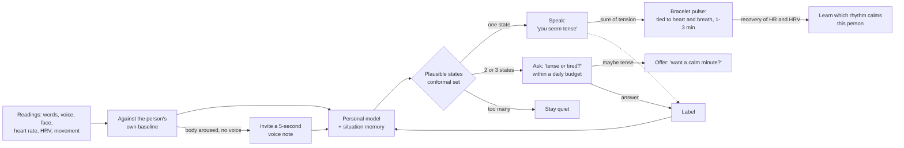
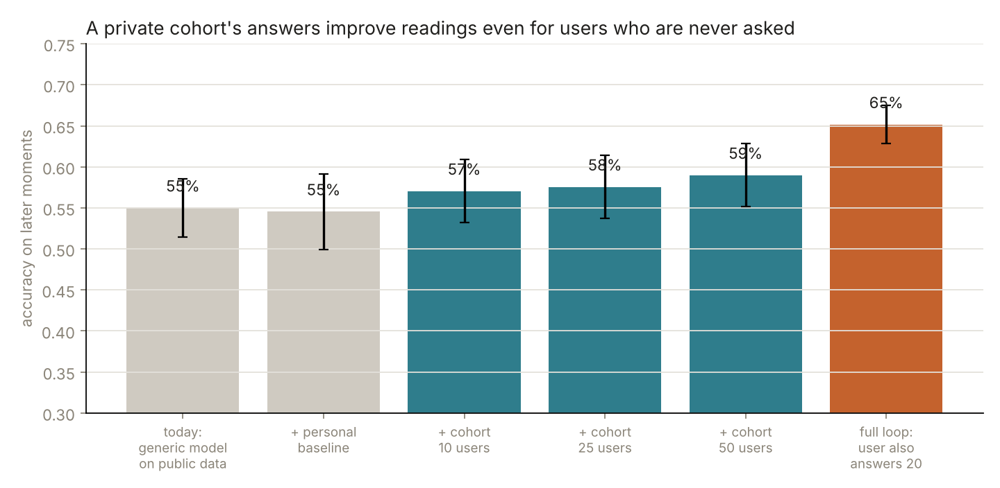
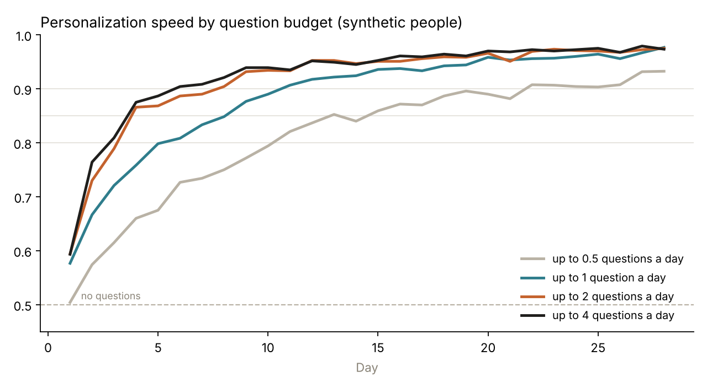
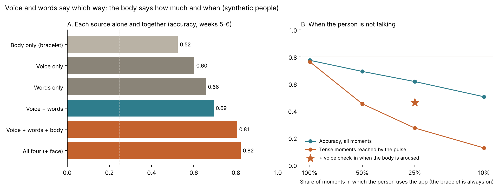
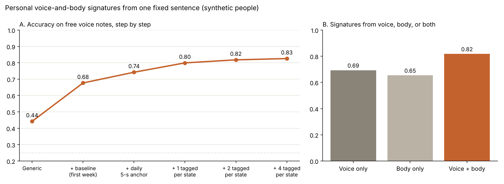
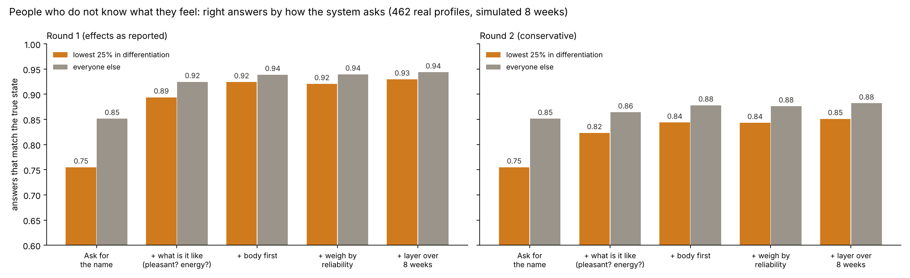
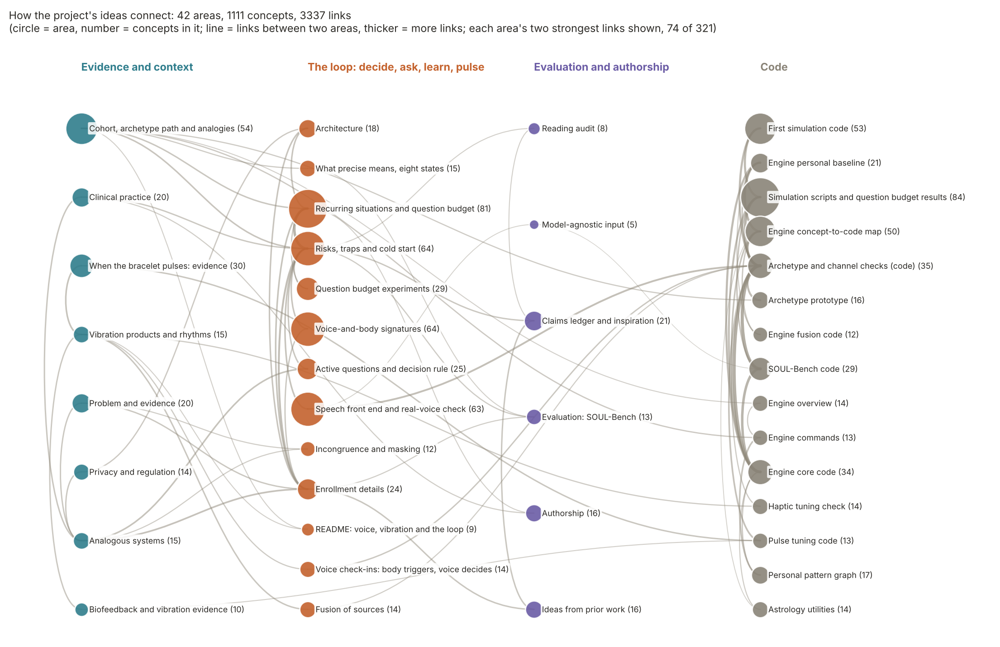

# SOUL-Calibrate

**Personal calibration, active questions and user-grounded evaluation for emotion-reading systems.**
A proposal for the SOUL layer of Nightlet, by **Emanuele De Bernardis** (November 2026).

> Emotion signals in voice, face and body are weak and highly personal in everyday life. A generic model
> cannot know when it is right for one person. SOUL-Calibrate gives every user a personal baseline and a model
> that learns from them, asks only when it is unsure, and measures everything against the user's own answers.

**In Nightlet's terms:** people want to feel understood, not optimized. SOUL-Calibrate sits on top of any SOUL
model, in-house or from a partner, and makes its reading right for this person. It decides when SOUL speaks,
asks "does this feel right?" or stays quiet, and so when the bracelet should pulse to calm. It learns on the
phone without breaking "never used for training", and measures every model against the user's own answers.

**Almost all numbers in this repository come from synthetic people.** They show how the method behaves, not how real
users are. The exception is the understanding layer, simulated on the profiles of 462 real people from five open
experience-sampling studies; the first checks on real data are E31 (real voice) and E32 (the pulse) in [docs/16](docs/16-experiments.md).

## Contents

1. [How it works](#how-it-works)
2. [The problem](#1-the-problem)
3. [The solution: a closed personal loop](#2-the-solution-a-closed-personal-loop)
4. [What the simulations show](#3-what-the-simulations-show)
5. [Voice, body and the bracelet](#4-voice-body-and-the-bracelet)
6. [Code Nightlet can run: `engine/soulcal`](#5-code-nightlet-can-run-enginesoulcal)
7. [How it is evaluated and tested](#6-how-it-is-evaluated-and-tested)
8. [What is not done yet](#7-what-is-not-done-yet)
9. [How the ideas connect: knowledge graph](#8-how-the-ideas-connect-knowledge-graph)
10. [Repository map, documents and quick start](#repository-map)

## How it works



Every answer, and every one-tap "not quite" (dotted line), improves the next reading of the same person and the
same kind of moment. The language model only writes the words of a reading; it never decides what the reading is.

## 1. The problem

- In the largest in-the-wild smartphone study (560 people), prosody predicted momentary valence at ρ = 0.02.
- 32.5–69.3% of the variance of voice features depends on who is speaking, not on how they feel.
- Audio-language models follow the words when the voice says otherwise.
- The body says "how much", not "which way": heart rate rises with excitement as with anxiety.
- Group-level findings often do not hold for the individual.

→ [docs/00-problem.md](docs/00-problem.md)

## 2. The solution: a closed personal loop

1. **Enrollment** (3–7 days): fixed sentences, resting physiology, two sliders and one word; later, the same
   sentence read in a clear state becomes the person's voice-and-body signature.
2. **Session anchor** (5 seconds): one neutral sentence + resting heart rate, so only the voice changes.
3. **Rolling personal baseline:** every signal is read against the person's own norm, with a drift trigger.
4. **Decision with a guarantee:** a conformal set of plausible states → **speak** (one state), **ask** (2–3
   states, offered as the options), or **stay quiet**.
5. **Personal head and situation memory:** each answer updates a small per-user model on the device, and every
   later reading of the same kind of moment.
6. **Support:** the bracelet pulses only when the reading is sure the person is tense, tuned to their heart and
   breathing; when the person is not talking, the body can invite a 5-second voice note.

→ [docs/01-architecture.md](docs/01-architecture.md)

## 3. What the simulations show

### First simulation: personalization and a private cohort

| Setting | Accuracy (4 states, chance 25%) |
| --- | --- |
| Today: generic model trained on public data | 0.550 |
| + answers from a private cohort of 50 users (for users never asked) | 0.590 |
| Full loop: the user also answers 20 questions | 0.652 |

A rolling baseline recovers after a step change in the signals (0.581 vs 0.541 for a fixed one), and with a
generic model Nightlet would have to ask at 76% of moments, so personalization comes before speaking and
questions need a budget. The generic model scores 0.578 in the personalization ladder and 0.550 here: this
setting adds a difference between public training data and real users. → [docs/18-simulation.md](docs/18-simulation.md)



### Recurring situations: one answer, every later reading of the same situation

6 recurring situations per person, a 7-day calibration week with at most one question a day, then 5 test days
without questions:

| Policy | Questions | Accuracy in the test days |
| --- | --- | --- |
| No questions (today) | 0 | 0.504 |
| Random moment, closed question | 7.0 | 0.751 |
| Ambiguous moment, closed question | 6.0 | **0.863** |

After one answer the same situation is read correctly 89% of the time, and the set of plausible states narrows
from 2.4 to 1.4 in a week. After the week Nightlet speaks in 72% of readings and is right 94% of the time when
it does (today: 7.5% and 82%). With a shared model trained only on public data, as Nightlet's privacy promise
requires, the gain grows as public data differ more from users. → [docs/20](docs/20-recurring-situations.md)


### How many questions? The user picks the speed

Every budget reaches about the same accuracy; more questions only get there sooner. Reaching 0.90 takes about
10–12 answers: about 3 weeks at one question every other day ("light"), 11 days at 1 a day ("standard"), 8 days
at 2 a day ("fast"). Beyond about 9 answers a week, questions stop helping, because the system only asks when it
is torn. Users choose the speed and the hours, and can leave free notes. → [docs/23](docs/23-question-budget.md)



### What "precise" means, and eight states

Every accuracy here means: the reading names the state the person would choose themselves, at that moment
(Nightlet's own definition: the user is the best source). It does not yet cover intensity, mixed states or
causes. With eight states (an intermediate state between each pair on the valence × arousal circle), the
question rule must also ask when more than three states are plausible; then eight states reach the same level
with about 50% more answers. → [docs/24](docs/24-what-precise-means.md)

### Coarse to fine: say what you know, at the level you know it

Ask about the fine states from day one, but show each reading at the level the model is sure of ("calm" before
"content"). With eight states, readings are right 0.75 of the time on day 3 and 0.85 after a week, against 0.55
and 0.75 when eight states are shown from the start, and the model learns just as fast. Switching to fine
questions only later slows learning. → [docs/25](docs/25-coarse-to-fine-and-archetypes.md)


### Learning from the cohort, and archetypes (future phase)

The goal is the path glucose monitors took, from finger-stick calibration to factory calibration: learn from
consenting users so new people need fewer questions. In a first synthetic check, a model pooled over the cohort
raises a new person's first-week accuracy by 3 to 5 points; archetypes (masks with words, flat voice, serious
face) add nothing on top of it yet, so the pooled cohort comes first. → [docs/25](docs/25-coarse-to-fine-and-archetypes.md)

### When words and face or voice disagree

The disagreement becomes a reason to ask, read against the person's own baseline: in the engine demo, questions
triggered by disagreement hit real masking 48% of the time (base rate 9%). → [docs/21](docs/21-text-face-incongruence.md)

## 4. Voice, body and the bracelet

**The body triggers, the voice decides, the vibration acts.**

### When the bracelet pulses

The pulse is where the reading becomes help, so it follows the same rule as the reading.

| The engine | The bracelet | Why |
| --- | --- | --- |
| Sure the person is tense, against their own baseline | **Pulse:** 1–3 minutes of a slow heartbeat at 80% of their heart rate right now, or a breathing pacer at their own resonance rate (learned, from 6 a minute); a line on screen; a calm voice only if the user turned it on | This is the moment it is for |
| Unsure, tense is possible | **Offer:** one soft tap, "Want a calm minute?"; the answer is also a label | An imposed pulse on a wrong reading costs trust |
| Calm, excited, low, or moving | Nothing | Excitement looks like stress to the body; exercise raises heart rate |

Gates: bracelet worn, not moving, at most 3 a day, 90 minutes apart, in the hours the user chose. 20% of eligible
moments are held out at random, so the effect is measured on the person's own recovery, and the rhythm that calms
them is learned.


In this synthetic check, **the effect of a pulse is an assumption**; what is measured is when the pulse fires.
Pulses triggered by the body alone land on excitement half the time and reach 3% of tense moments; the calibrated
decision reaches 56% with 88% of pulses at tense moments. The better the reading, the more often the pulse can
help without false alarms. → [docs/26-when-to-pulse.md](docs/26-when-to-pulse.md)

### Voice and body: which matters?

They answer different questions. The bracelet is always on and says how much and when; voice and words come in
short moments and say which way. Alone, the body reads 0.52 and never dares to speak, voice and words 0.69; together
0.81, and the engine speaks almost twice as often. Voice moments also teach the body-only moments: when half the
moments have voice, the body-only ones are read at 0.67, against 0.52 for a bracelet that never hears the person.
The less the person talks, the fewer tense moments the pulse can reach (76% → 13%), so at a body-only moment with
an aroused body and possible tension the app invites a 5-second voice note, at most once a day: about two
invitations a week raise the tense moments reached from 28% to 46%. Voice stays episodic and chosen, never
always-on listening (Amazon's always-listening band was criticised and discontinued).



### Listening well from day one: open speech models

Voice is an input: the person talks to the app, the bracelet does not speak. One voice note gives two signals:
the words (speech recognition: Whisper, Parakeet, as in the open-source Handy app, or SenseVoice) and the way they
are said (speech emotion: emotion2vec+, SenseVoice), both on the phone and both swappable. In a synthetic check,
stronger front ends raise the generic reading from 0.62 to 0.82 and beyond, and personal calibration still adds
on top (+0.16 today, +0.08 with much stronger models), because masking and personal habits belong to the person,
not to the model. The first check on real voice is ready to run: `realvoice/e31_real_voice.py` (RAVDESS,
emotion2vec+, leave one speaker out). → [docs/28-speech-front-end.md](docs/28-speech-front-end.md)

### Your voice, your body, your signature

One fixed sentence, three uses: read in a normal tone in the first week (the person's usual voice and body), once
each evening (today's microphone and room), and, when the person feels a clear state, read again while they say
how they feel. Same words, so only the voice and the body differ: the difference becomes **their own signature**
of that state, in pitch, energy, speech rate, pauses, heart rate, HRV and skin temperature. In a synthetic check,
accuracy on free voice notes climbs from 0.44 (generic) to 0.68 with the baseline, 0.74 with the daily anchor and
0.82 with two tagged readings per state; voice and body together beat either alone (0.69 and 0.65). The app can
show the signature back ("when you're tense, your voice gets faster and your heart rate rises by 12"): the person
learns themselves too. All of it is voluntary: in the light mode (about 1 minute a week: the 5-second evening
anchor, one sentence a week, a question every other day) the signature reads 0.74 after six weeks; standard
(1.5 minutes) 0.82; fast (2.5 minutes, a sentence a day) 0.82 in week 3 and 0.86 by week 6. The evening anchor is
the cheapest, most valuable feedback. Voice and body end up in **one reading** of the person's state: the signature is
the engine's voice channel. In the full loop (two voice notes a day, one question a day) the reading goes from
0.41 with today's public approach (generic speech model, population body norms) and 0.57 for the engine without the
signature to 0.81, and from 52% and 61% to 88% right when it speaks. → [docs/29-voice-signatures.md](docs/29-voice-signatures.md)



### Understanding yourself: the understanding layer

After the conversation with Nightlet's founder: the reflective part of SOUL (astrology included) is a way in, not a
signal, a language that leads a young person to look at their own feelings. The understanding layer helps the
person put the reading into words, notice it in the body (the signature, the heartbeat pulse), see their own
patterns, and talk to someone when it lasts. A symbolic lens can frame a prompt; the content is always the person's
own data. In open experience-sampling data from five studies (462 real people), **people with more negative affect
tell their negative emotions apart less well** (rho = -0.27). Simulating those people for 8 weeks with effects taken
from published studies, prompts at hard moments cut the confusion between tense and low from 0.30 to 0.17 (0.24 in a
conservative round) and negative affect by 10% (4%) for people who need it, while people doing well get about one
prompt a week and no change. The layer doses itself; a person-level gate does worse; the step towards a person
reaches 12-16% of people who need it and almost none of the others.


For people who do not really know what they feel, the system does not ask for the name of the feeling: it asks
whether it is pleasant and how much energy there is ("not sure" allowed), shows their own body signals first, and
weighs each answer by how much that person's answers can be trusted. In the same simulation the right answers of the
quarter of people who find it hardest rise from 0.75 to 0.89 (0.82 conservative), close to everyone else. → [docs/30-understanding-layer.md](docs/30-understanding-layer.md)



### Tuning the pulse to each person

Products that calm with vibration are triggered on demand (doppel, TouchPoints, Apollo) or automatically against a
personal threshold (NightWare, FDA-authorised for PTSD nightmares; Lief). SOUL-Calibrate keeps both, with the
reading as the automatic trigger. The heartbeat is tied to the heart rate right now (80%, never above 90%), because
a heartbeat faster than one's own raises anxiety and a fixed 60 a minute is sometimes faster; the breathing pacer
learns the person's resonance rate (between 4.5 and 7 a minute). In a synthetic check with effects taken from the
literature, the live-heart-rate heartbeat beats a fixed one (0.72 vs 0.53) and learned breathing reaches 0.81 after
a few weeks (0.71 at a fixed 6 a minute). → [docs/27-voice-and-vibration.md](docs/27-voice-and-vibration.md)

## 5. Code Nightlet can run: `engine/soulcal`

A small Python package (numpy only). It takes what the device and app already produce (facial, speech and text
model outputs; heart rate, HRV, skin temperature, movement) and returns speak / ask / quiet for every reading.
It learns from answers and one-tap corrections, flags when words and expression disagree, and keeps its state
in a JSON file on the phone.

| Module | What it does | Docs |
| --- | --- | --- |
| `engine.SoulEngine` | baseline, fusion, situation memory, conformal decision, question budget, answers, corrections, notes | [22](docs/22-engine.md) |
| `bench.soul_bench` | SOUL-Bench ladder B0–B6 on any readings with self-reports: in-house and partner models compared the same way | [08](docs/08-evaluation-soul-bench.md) |
| `patterns` | personal pattern graph (context, body, expression, astrology) with false-discovery correction and replication | [22](docs/22-engine.md) |
| `detail.level_of_detail` | shows a main state until the fine one is sure, on top of any model with finer labels | [25](docs/25-coarse-to-fine-and-archetypes.md) |
| `archetypes` | prototype: archetypes from a consenting cohort, new people matched after 4 days | [25](docs/25-coarse-to-fine-and-archetypes.md) |
| `support.SupportPolicy` | when and how the bracelet pulses; held-out moments; rhythm, live-heart-rate heartbeat and resonance breathing learned per person | [26](docs/26-when-to-pulse.md), [27](docs/27-voice-and-vibration.md) |
| `channels_sim`, `haptics_sim` | synthetic checks: voice, words, face and body; voice check-ins; tuning the pulse | [27](docs/27-voice-and-vibration.md) |
| `understanding` | understanding layer: need gate, granularity index, reflective prompts with an optional lens; for people who do not know what they feel, questions on what it is like, body first and answer reliability; checked on 462 people from open ESM data | [30](docs/30-understanding-layer.md) |
| `anchors.SignatureModel` | voice-and-body signatures from one fixed sentence: enrollment, daily anchor, tagged readings; what changes in the person | [29](docs/29-voice-signatures.md) |

| Engine demo, 20 synthetic people | Accuracy, week 6 | Accuracy when speaking |
| --- | --- | --- |
| Today: generic reading | 0.57 | 0.68 |
| Personal baseline only | 0.63 | 0.87 |
| Engine (baseline + questions + corrections + memory) | **0.77** | **0.94** |

```python
from soulcal import SoulEngine, Profile, Reading
eng = SoulEngine(Profile("user-42"))
d = eng.observe(Reading("user-42", ts, face=face_probs, voice=voice_probs, text=text_probs,
                        heart_rate=71, hrv_rmssd=38))
if d.action == "ask":
    show_question(d.options)                 # e.g. ["tense", "tired"]
eng.answer(d.reading_index, "tense")
eng.save("user-42.json")                     # stays on the device
```

Full outputs: [DEMO](engine/examples/demo_out/DEMO.md) · [PATTERNS](engine/examples/demo_out/PATTERNS.md) ·
[ARCHETYPES](engine/examples/demo_out/ARCHETYPES.md) · [SUPPORT](engine/examples/demo_out/SUPPORT.md) ·
[CHANNELS](engine/examples/demo_out/CHANNELS.md) · [HAPTICS](engine/examples/demo_out/HAPTICS.md) ·
[ANCHORS](engine/examples/demo_out/ANCHORS.md).
→ [docs/22-engine.md](docs/22-engine.md)

## 6. How it is evaluated and tested

- **SOUL-Bench:** one harness for in-house and partner models, with the user's answers as ground truth, people
  kept apart between training and test, and a ladder of baselines. → [docs/08](docs/08-evaluation-soul-bench.md)
- **Private cohort pilot:** a consented group's answers improve readings for users who are never asked. → [docs/19](docs/19-private-cohort-pilot.md)
- **Clinical methods** for timing and testing: just-in-time adaptive interventions, micro-randomised trials,
  outcome monitoring, HRV biofeedback, alarm fatigue. → [docs/12](docs/12-clinical-practices.md)
- **Reading audit:** the language model writes the reading but never decides it. → [docs/14](docs/14-reading-audit.md)
- **Privacy and regulation:** personal learning on the device, shared training only with separate consent;
  emotion recognition is high-risk under the EU AI Act. → [docs/09](docs/09-privacy-and-regulation.md)
- **Experiment plan:** E1–E43, each with what would prove it wrong. → [docs/16](docs/16-experiments.md)

## 7. What is not done yet

- **Real data.** Everything is synthetic, except the profiles behind the understanding layer (462 real people, open data). The first experiment on real audio (E31) is written and tested on
  generated audio, signatures included (RAVDESS actors read the same sentences in every emotion); it needs a machine
with internet to download emotion2vec+ and RAVDESS: `realvoice/`.
- **The pulse's effect.** It is assumed in the checks; it has to be measured on a consenting cohort (E32), with
  voice check-ins (E33) and the tuning of the rhythm (E34); signatures and whether seeing them helps (E35, E36); the understanding layer (E37–E40) and people who do not know what they feel (E41–E43).
- **Still on paper:** the enrollment screens in the app (the logic is in `anchors.py`), the reading audit batteries, the cohort pilot, the
  micro-randomised trials, support for "low", and an engine with more than four states (`detail.py` works on top).

## 8. How the ideas connect: knowledge graph

The project was mapped with [Graphify](https://pypi.org/project/graphifyy/) after every step: 1,364 concepts and
4,152 links across documents and code, grouped into areas. Read left to right: where an idea comes from
(evidence), how it becomes part of the loop, how it is evaluated, and where it is built in code. Each circle is an
area, each line the links between two areas (thicker = more); every area's two strongest links are drawn, so none is
left without a line, and arcs on the left of a column join areas of the same group.



Each round of the graph pointed at the next fix: active questions turned out to be the bridge of the whole system
(so answer rate is the first metric); the situation memory and the personal head were joined; the coarse-to-fine
question and the glucose-monitor idea got code and a test; the pulse and then voice and vibration became among the most
connected documents, because they are where the reading, the budget and the evaluation meet; the voice-and-body signature moved from beside the engine to one of its bridges (docs/29: 100 links into 20 areas);
in the last round the understanding layer joined 19 areas (docs/30), with its own area for people who do not know what they feel and answers weighed by how far each person's answers can be trusted. **Open the interactive map
[`graph/map.html`](graph/map.html)** (works offline) to follow any concept to its sources and its code.
→ [graph/README.md](graph/README.md), [graph/GRAPH_REPORT.md](graph/GRAPH_REPORT.md)

## Repository map

| Path | What it holds |
| --- | --- |
| `docs/00`–`docs/29` | one module per component, each ending with a **Check** |
| `docs/references.md` | every source, grouped by module |
| `sim/` | simulation code, tests, results and figures |
| `engine/` | the `soulcal` package: engine, command line, demo outputs and tests |
| `realvoice/` | E31, the first check on real voice with an open speech-emotion model (runs where models can be downloaded) |
| `graph/` | knowledge graph: overview image, interactive map, report and data |
| `AUTHORS.md` | authorship and original contributions |

### Documents

| | | |
| --- | --- | --- |
| [00 Problem](docs/00-problem.md) | [09 Privacy and regulation](docs/09-privacy-and-regulation.md) | [18 Simulation](docs/18-simulation.md) |
| [01 Architecture](docs/01-architecture.md) | [10 Risks](docs/10-risks.md) | [19 Private cohort pilot](docs/19-private-cohort-pilot.md) |
| [02 Enrollment](docs/02-enrollment.md) | [11 Analogous systems](docs/11-analogous-systems.md) | [20 Recurring situations](docs/20-recurring-situations.md) |
| [03 Session anchor](docs/03-session-anchor.md) | [12 Clinical practice](docs/12-clinical-practices.md) | [21 Words vs face](docs/21-text-face-incongruence.md) |
| [04 Rolling baseline](docs/04-rolling-baseline.md) | [13 Ideas from prior work](docs/13-ideas-from-prior-work.md) | [22 Engine](docs/22-engine.md) |
| [05 Active questions](docs/05-active-questions.md) | [14 Reading audit](docs/14-reading-audit.md) | [23 Question budget](docs/23-question-budget.md) |
| [06 Personal model](docs/06-personal-model.md) | [15 Labels and consent](docs/15-labels-and-consent.md) | [24 What precise means](docs/24-what-precise-means.md) |
| [07 Fusion](docs/07-fusion.md) | [16 Experiment plan](docs/16-experiments.md) | [25 Coarse to fine and archetypes](docs/25-coarse-to-fine-and-archetypes.md) |
| [08 SOUL-Bench](docs/08-evaluation-soul-bench.md) | [17 Roadmap and governance](docs/17-roadmap-and-governance.md) | [26 When to pulse](docs/26-when-to-pulse.md) |
| | | [27 Voice and vibration](docs/27-voice-and-vibration.md) |
| | | [28 Speech front end](docs/28-speech-front-end.md) |
| | | [29 Voice signatures](docs/29-voice-signatures.md) |
| | | [30 Understanding layer](docs/30-understanding-layer.md) |

Start with `docs/00-problem.md`, then follow the links, or start from the map.

## Quick start

```bash
cd sim
pip install -r requirements.txt
python -m pytest -q tests                           # 17 tests
python run_simulation.py --seeds 5 --out results    # first simulation
python run_situations.py --seeds 5 --out results    # recurring situations
python run_budget.py --seeds 5 --out results        # question budget, timing, spreading
python run_speed.py --seeds 5 --out results         # personalization speed
python run_user_control.py --seeds 5 --out results  # chosen hours, free notes, consensus memory
python run_states.py --seeds 5 --out results        # four vs eight states
python run_progressive.py --seeds 5 --out results   # coarse to fine
cd ../engine
python -m pytest -q tests                           # 28 tests
python -m soulcal demo --out examples/demo_out      # today vs the engine
python -m soulcal archetypes --out examples/demo_out
python -m soulcal support --out examples/demo_out   # when the bracelet pulses
python -m soulcal channels --out examples/demo_out  # voice, words, face and body
python -m soulcal haptics --out examples/demo_out   # tuning the pulse
python -m soulcal anchors --out examples/demo_out   # voice-and-body signatures, alone and in the engine
python -m soulcal understanding --out examples/demo_out   # the understanding layer and the answers, 462 people from open data
python -m soulcal bench --readings my.csv           # SOUL-Bench on your own readings
cd ../sim && python plot_support.py && python plot_channels.py && python plot_anchors.py && python plot_understanding.py ../engine/soulcal/data/esm_profiles.json ../engine/examples/demo_out/understanding.json results/fig11_understanding_layer.png
python plot_answers.py ../engine/examples/demo_out/understanding.json results/fig12_answers.png   # figures 8-12
cd .. && python -m pytest -q realvoice/tests            # E31 protocol, no download
python realvoice/e31_real_voice.py --data path/to/RAVDESS --encoder emotion2vec   # E31 on real voice
python graph/build_overview.py                      # graph overview image
```

## Author and license

© 2026 Emanuele De Bernardis. Released under the MIT License: free to use, modify and build on, keeping the
copyright notice. See [AUTHORS.md](AUTHORS.md) for the original contributions and [CITATION.cff](CITATION.cff) to cite this work.
