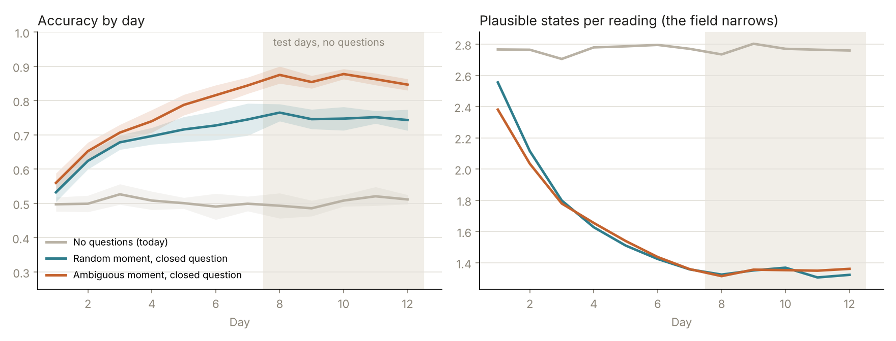

# SOUL-Calibrate

**Personal calibration, active questions and user-grounded evaluation for emotion-reading systems.**
A proposal for the SOUL layer of Nightlet, by **Emanuele De Bernardis** (November 2026).

> Emotion signals in voice, face and body are weak and highly personal in everyday life. A generic model
> cannot know when it is right for one person. SOUL-Calibrate gives every user a personal baseline and a model
> that learns from them, asks only when it is unsure, and measures everything against the user's own answers.

## 1. The problem

- In the largest in-the-wild smartphone study (560 people), prosody predicted momentary valence at ρ = 0.02.
- 32.5–69.3% of the variance of voice features depends on who is speaking, not on how they feel.
- Audio-language models follow the words when the voice says otherwise.
- Group-level findings often do not hold for the individual.

→ [docs/00-problem.md](docs/00-problem.md)

## 2. The solution: a closed personal loop

1. **Enrollment** (3–7 days): fixed sentences, resting physiology, two sliders and one word.
2. **Session anchor** (5 seconds): one neutral sentence + resting heart rate, so only the voice changes.
3. **Rolling personal baseline:** every signal is read against the person's own norm, with a drift trigger.
4. **Decision with a guarantee:** a conformal set of plausible states → **speak** (one state), **ask** (2–3
   states, offered as the options), or **stay quiet**.
5. **Personal head:** each answer updates a small per-user model on the device.

→ [docs/01-architecture.md](docs/01-architecture.md)

## 3. How it is used and tested

- **SOUL-Bench:** one harness for in-house and partner models, with the user's answers as ground truth and a ladder of baselines. → [docs/08](docs/08-evaluation-soul-bench.md)
- **Private cohort pilot:** a consented group's answers improve readings even for users who are never asked. → [docs/19](docs/19-private-cohort-pilot.md)
- **Clinical methods** for timing and testing: just-in-time adaptive interventions, micro-randomised trials, outcome monitoring, HRV biofeedback, alarm fatigue. → [docs/12](docs/12-clinical-practices.md)
- **Reading audit:** the language model writes the reading but never decides it. → [docs/14](docs/14-reading-audit.md)

## 4. What a simulation shows (synthetic users, not real people)

| Setting | Accuracy (4 states, chance 25%) |
| --- | --- |
| Today: generic model trained on public data | 0.550 |
| + answers from a private cohort of 50 users (for users never asked) | 0.590 |
| Full loop: the user also answers 20 questions | 0.652 |

Also: a rolling baseline recovers after a step change in the signals (0.581 vs 0.541 for a fixed one), and
with a generic model Nightlet would have to ask at 76% of moments, so personalization comes before speaking
and questions need a budget. → [docs/18-simulation.md](docs/18-simulation.md)

The generic model scores 0.578 in the personalization ladder and 0.550 above: the second setting adds a
difference between public training data and real users.


### Recurring situations: one answer, every later reading of the same situation

People live in recurring situations, each with a personal signal signature. In a second simulation (6 recurring
situations per person, a 7-day calibration week with at most one question a day, then 5 test days without questions):

| Policy | Questions | Accuracy in the test days |
| --- | --- | --- |
| No questions (today) | 0 | 0.504 |
| Random moment, closed question | 7.0 | 0.751 |
| Ambiguous moment, closed question | 6.0 | **0.863** |

After one answer, the same situation is read correctly 89% of the time (vs 50% for the same moments without
questions), and the set of plausible states narrows from 2.4 to 1.4 in a week. After the week Nightlet speaks in
72% of readings and is right 94% of the time when it does (today: 7.5% and 82%). With a shared model trained only
on public data, as Nightlet's privacy promise requires, the gain grows as the public data differ more from users.
The same experiments surface two new problems, coverage after personalization and life changes, with their fixes. → [docs/20-recurring-situations.md](docs/20-recurring-situations.md)



When words and face or voice disagree, the disagreement becomes a reason to ask, read against the person's own
baseline. → [docs/21-text-face-incongruence.md](docs/21-text-face-incongruence.md)

## 5. Code Nightlet can run: `engine/soulcal`

A small Python package (numpy only) that takes what the device and app already produce (facial, speech and
text model outputs; heart rate, HRV, skin temperature, movement) and returns speak / ask / quiet for every
reading, learns from answers and one-tap corrections, flags when words and expression disagree, and keeps its
state in a JSON file on the phone. `soulcal bench` runs the SOUL-Bench ladder B0–B6 on any readings with
self-reports, so in-house and partner models are compared the same way. It also builds a personal pattern graph (context, body, expression and the
astrology reflection layer) with false-discovery correction and replication, so chance patterns are never
shown as findings.

| Demo, 20 synthetic people | Accuracy, week 6 | Accuracy when speaking |
| --- | --- | --- |
| Today: generic reading | 0.57 | 0.68 |
| Engine (baseline + questions + corrections + memory) | **0.77** | **0.94** |

```bash
cd engine && python -m pytest tests -q && python -m soulcal demo --out examples/demo_out
```

→ [docs/22-engine.md](docs/22-engine.md)

## Repository map

| Path | What it holds |
| --- | --- |
| `docs/00`–`docs/22` | one module per component, each ending with a **Check** |
| `docs/references.md` | every source, grouped by module |
| `sim/` | simulation code, tests, results and figures |
| `engine/` | the `soulcal` package: usable engine, command line, demo outputs and tests |
| `graph/` | knowledge graph of the project (Graphify): report, data and interactive map |
| `AUTHORS.md` | authorship and original contributions |

Start with `docs/00-problem.md`, then follow the links. The interactive map `graph/map.html` opens in any
browser without an internet connection.

## Quick start

```bash
cd sim
pip install -r requirements.txt
python -m pytest -q tests                      # 15 tests
python run_simulation.py --seeds 5 --out results
python run_situations.py --seeds 5 --out results
cd ../engine
python -m pytest -q tests                      # 13 tests
python -m soulcal demo --out examples/demo_out
```

## Author and license

© 2026 Emanuele De Bernardis. Released under the MIT License: free to use, modify and build on, keeping the
copyright notice. See [AUTHORS.md](AUTHORS.md) for the original contributions and [CITATION.cff](CITATION.cff) to cite this work.
