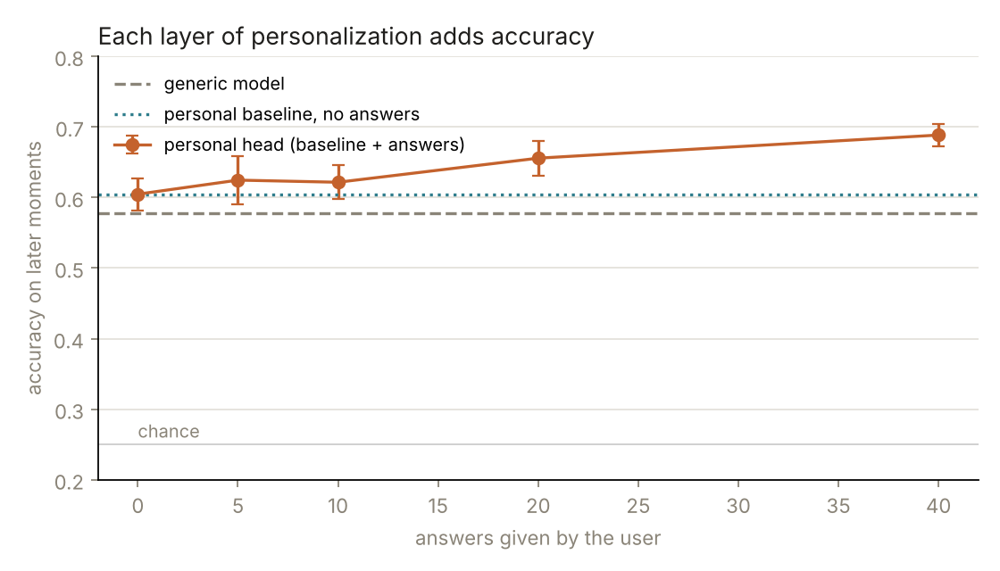
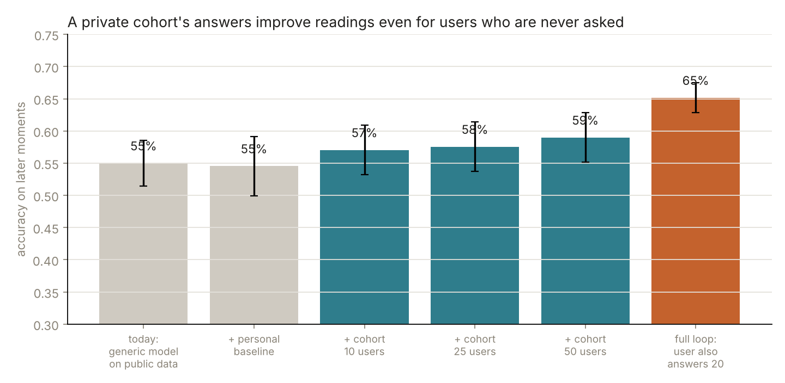
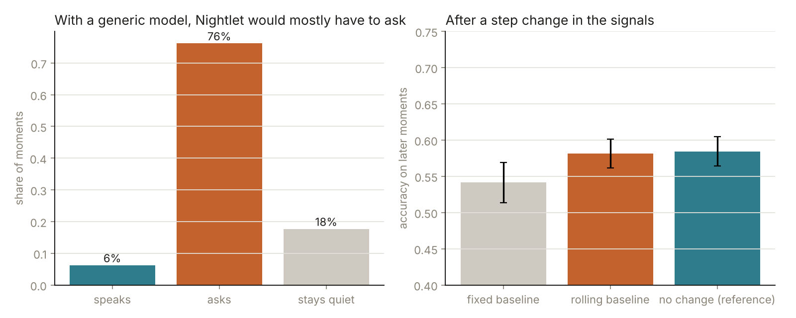
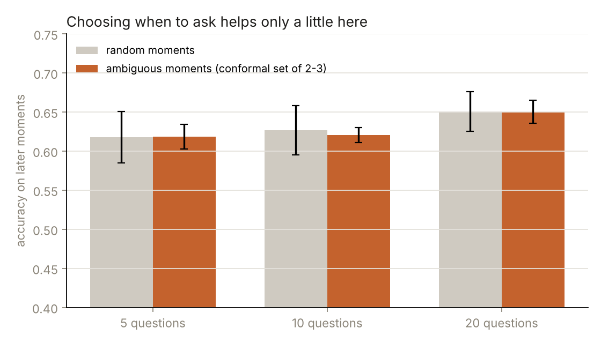
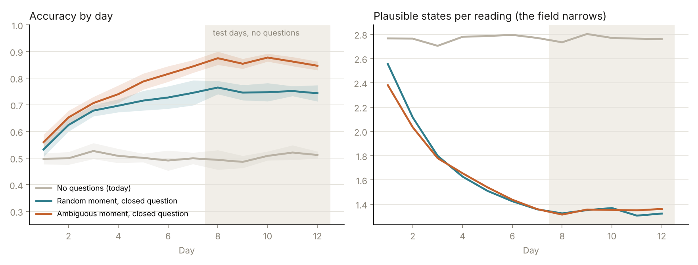

# 18 — Simulation: what the method does on synthetic users

Author: Emanuele De Bernardis · Module: Simulation · Code: [`sim/`](../sim) · Full tables: [`sim/results/RESULTS.md`](../sim/results/RESULTS.md)

**Provenance: SIMULATED.** Synthetic users, 5 seeds. The simulation shows how the method behaves and how it
is evaluated. It makes no claim about real people.

## The synthetic world

Each user has a latent valence/arousal trajectory around a personal mean. The observed signals mix a large
personal offset (who is speaking), a personal expression gain (how this person shows affect) and noise. The
state is one of four quadrants (calm, energized, tense, low); chance is 25%. Self-reports are right 85% of
the time. Accuracy is always measured on later moments, never on the moments the user was asked about.

## Results

| Experiment | Result |
| --- | --- |
| A. Personalization ladder | generic 0.578 → personal baseline 0.605 → personal head with 40 answers 0.689 |
| B. Ambiguous vs random question moments | no clear difference (e.g. 0.651 vs 0.650 at 20 questions) |
| C. Conformal sets (target 90%) | coverage 0.905; with a generic model the set is ambiguous at 76% of moments |
| D. Step change in signals | fixed baseline 0.541, rolling 0.581, no-change reference 0.584 |
| E. Cohort transfer (users never asked) | today 0.550 → cohort of 50 users 0.590; full loop 0.652 |
| F. Recurring situations ([[20-recurring-situations]]) | no questions 0.504 → random moments 0.751 → ambiguous moments, closed questions 0.863; same situation after one answer 0.892 |
| G. Public data only (Nightlet's constraint) | the more public data differ from users, the larger the gain: +0.36, +0.38, +0.40 |
| H. New problems | coverage 0.855 with random questions (0.881 with adaptive conformal, 0.930 with ambiguous questions); after a subtle life change, one-tap corrections recover best (0.649 → 0.711) |







## What this says, and what it does not

- **Personalization is the main lever:** every layer adds accuracy, and the loop gains about 10 points over today's approach on these synthetic users.
- **A private cohort helps everyone:** answers from 50 consented users raise accuracy for new users who are never asked (0.550 → 0.590). → [[19-private-cohort-pilot]]
- **Choosing when to ask helps when situations recur:** with a mood that drifts at every moment (part B) ambiguous and random timing tie; with recurring situations (part F) ambiguous timing wins clearly, closed questions beat open ones, and the set of plausible states narrows from 2.4 to 1.4 states in a week. It must be tested on real people (E3, E15, E20).
- **A budget is not optional:** with a generic model Nightlet would have to ask at three moments out of four.
- **With public data that differ from real users, person normalisation alone did not help** (0.550 vs 0.545); it helps when the shared model is trained on in-domain data (experiment A).

## Reproduce

```bash
cd sim
pip install -r requirements.txt
python -m pytest -q tests
python run_simulation.py --seeds 5 --out results
```
