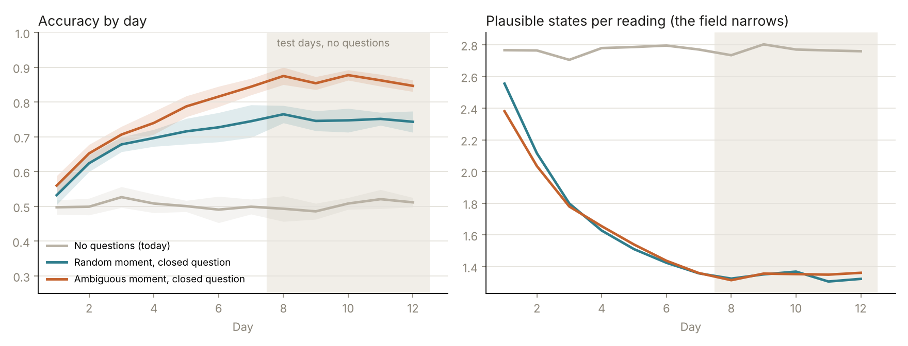

# 20 — Recurring situations: one answer, every later reading of the same situation

Author: Emanuele De Bernardis · Module: Recurring situations · Extends: [[05-active-questions]], [[06-personal-model]], [[18-simulation]] · Experiment: E20 in [[16-experiments]]

**Original contribution (E. De Bernardis):** people live in recurring situations (the evening after a long
work call, the gym, dinner with a partner), each with its own personal signal signature. A question asked when
the generic model narrows the field to two or three states should make every later reading of *that same
situation* precise. The calibration days are spent learning the person's own situations, not the population.

## Why a second experiment

The first active-question experiment ([[18-simulation]], part B) measured accuracy on later moments in
general, with a mood that drifts from moment to moment. In that world an answer about one moment says little
about the next, and choosing ambiguous moments did not beat random ones. This experiment asks the narrower
question: when the same situation comes back, is it read better because the user answered about it once?

## The world

- Four states. Each state has a population prototype; each person distorts it in a personal way, so the
  generic model is often torn between two or three states for that person (mean set size 2.8).
- Each person has 6 recurring situations with a usual state, a personal signature and a frequency.
- 4 readings a day; a calibration week of 7 days with at most one question a day; then 5 test days with no
  questions. Features are already centred on the person's baseline ([[04-rolling-baseline]]).
- The model never sees which situation it is: it recognises a situation only by its signal.
- **Personal memory:** each answer is stored with its signal. A new reading adds, to the population
  log-probabilities, the evidence of stored answers weighted by a Gaussian kernel on signal distance.
- **Closed question:** the options are the states of the conformal set, plus "neither" (then an open answer).
  **Open question:** the user names the state freely, with a higher error (15% vs 5%).
- Every policy sees the same people and the same moments: only the questions differ, so differences are causal
  within the simulation.

## Results (5 seeds, 60 people each; full tables in `sim/results/SITUATIONS.md`)

| Policy | Questions per person | Accuracy, test days | Same situation after the answer | Same moments without questions |
| --- | --- | --- | --- | --- |
| No questions (today) | 0 | 0.504 | – | – |
| Random moment, closed | 7.0 | 0.751 | 0.840 | 0.510 |
| Ambiguous moment, closed | 6.0 | **0.863** | **0.892** | 0.497 |
| Ambiguous and not yet known, closed | 4.4 | 0.816 | 0.853 | 0.499 |
| Ambiguous moment, open | 6.4 | 0.794 | 0.838 | 0.499 |

- **The same situation is read correctly about 9 times in 10 after one answer** (0.892), where the same moments
  without questions are read correctly half the time (0.497).
- **Timing matters when situations recur:** ambiguous moments beat random moments (0.863 vs 0.751) with fewer
  questions (6.0 vs 7.0). Random questions are often spent on situations the model already reads well.
- **Closed questions beat open ones** (0.863 vs 0.794): offering the two or three plausible states lowers the
  answer error, and the set already contains the truth 90% of the time.
- **The field narrows day by day:** the mean number of plausible states falls from 2.4 on day 1 to 1.4 by day 7,
  and stays there in the test days without further questions.
- **Spill-over:** answers also help situations never asked about (0.620 vs 0.519), because situations with the
  same state share the person's own version of that state.
- **Value of information:** skipping moments the memory already covers uses 27% fewer questions (4.4) and gives
  the most accuracy per question (+0.071 per question vs +0.060 for ambiguous and +0.035 for random).

## How stable situations must be

| Stability (situation brings its usual state) | No questions | Random | Ambiguous |
| --- | --- | --- | --- |
| 1.0 | 0.504 | 0.751 | 0.863 |
| 0.8 | 0.512 | 0.681 | 0.784 |
| 0.6 | 0.509 | 0.656 | 0.742 |

The advantage shrinks as situations become less predictable but holds at every level tested. For the product
this means: the more regular a person's evenings, the faster the calibration week pays off.

## What it means for the product

1. Spend the calibration week on the person's own situations: ask when the field is narrowed to two or three
   states, with closed options, at most once a day.
2. Stop asking about what is already known (the memory's coverage) and spend questions on new situations.
3. Keep 5–10% of questions at random ordinary moments, against selection bias ([[05-active-questions]]).
4. A situation that changes its usual state shows up as repeated corrections: that is the drift signal of
   [[04-rolling-baseline]] at situation level.

## Limits

- Synthetic people: situations are cleaner and more regular than real evenings.
- The model recognises situations from signals alone; real context (time, place, calendar) would help further
  but raises privacy questions ([[09-privacy-and-regulation]]).
- The answer error rates (5% closed, 15% open) are assumptions to be measured in the pilot ([[19-private-cohort-pilot]]).

## Check

- E20: on real users, accuracy on the second and later occurrences of an answered situation vs a micro-randomised
  control where the question was not asked ([[12-clinical-practices]]).
- `python run_situations.py --seeds 5 --out results` reproduces every number above; `tests/test_situations.py`
  checks the memory, the closed answers and the main effect.
