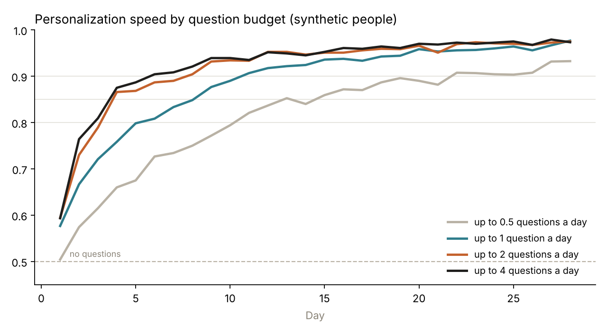

# 23 — How many questions: budget, timing and personalization speed

Author: Emanuele De Bernardis · Module: Question budget · Extends: [[05-active-questions]], [[20-recurring-situations]], [[15-labels-and-consent]] · Experiments: E24–E26 in [[16-experiments]]

**Original contribution (E. De Bernardis):** the number of questions is not a fixed setting but a speed the
user chooses. Every budget tested reaches about the same accuracy; more questions only get there sooner. The
system asks only when the model is torn, so the budget is spent on what it does not know yet, and the user
decides how many questions, when, and whether to add free notes.

All results: synthetic people (6 recurring situations, 4 readings a day), 5 seeds × 60 people, questions at
ambiguous moments with closed options unless stated. Scripts: `sim/run_budget.py`, `sim/run_speed.py`,
`sim/run_user_control.py`; tables in `sim/results/BUDGET.md`, `SPEED.md`, `USER_CONTROL.md`.

## 1. When a question is asked

- **Ambiguous moment:** the conformal set holds 2 or 3 states, the model is torn. The question offers exactly
  those states. Once answered, the same situation is no longer ambiguous, so later questions move to situations
  not learned yet.
- **Random moment:** any reading, often one the model already reads well. Spent questions teach little.
- **No question** when the model is sure (1 state), too lost (4 states), the signal is poor, or the day's budget
  or the user's chosen hours exclude it.

## 2. More questions do not raise the ceiling: they raise the speed

Questions allowed for 28 days, every reading scored before learning ([[18-simulation]]):

| Questions allowed per day | Day 3 | Day 7 | Day 14 | Day 28 | Days to 0.80 | Days to 0.85 | Days to 0.90 | Questions asked by day 7 / 14 / 28 |
| --- | --- | --- | --- | --- | --- | --- | --- | --- |
| None | 0.50 | 0.50 | 0.50 | 0.50 | – | – | – | 0 |
| 0.5 (every other day) | 0.61 | 0.73 | 0.84 | 0.93 | 11 | 14 | 23 | 2.8 / 6.0 / 9.8 |
| 1 | 0.72 | 0.83 | 0.92 | 0.98 | 6 | 8 | 11 | 5.9 / 9.9 / 14.6 |
| 2 | 0.79 | 0.89 | 0.95 | 0.97 | 4 | 5 | 8 | 8.4 / 12.1 / 16.2 |
| 4 | 0.81 | 0.91 | 0.95 | 0.97 | 3 | 4 | 7 | 9.0 / 12.5 / 16.7 |

- Reaching 0.90 takes about **10–12 answers whatever the budget**; the budget decides how many days that takes.
- **2 a day is the sweet spot:** 4 a day is only one day faster, because the system runs out of ambiguous
  moments (it asks only about 9 questions in the first week even when 28 are allowed).
- The same total spread over longer calibration gives the same result: 6 questions in 7 days (1/day), 14 days
  (0.5/day) or 28 days (0.25/day) all reach 0.86.

Check in the harder engine demo (`engine/`, 3 readings a day, missing channels, masking): week 6 accuracy 0.63
with no questions, 0.77 with 1 a day, 0.81 with 2, 0.81 with 3; questions asked fall from about 11 a week to 8
as the model learns.

## 3. Ambiguous beats random, at every budget

| Questions allowed per day (7-day week) | Random: questions / accuracy | Ambiguous: questions / accuracy |
| --- | --- | --- |
| 0.5 | 3.0 / 0.696 | 2.8 / 0.728 |
| 1 | 7.0 / 0.751 | 6.0 / 0.863 |
| 2 | 14.0 / 0.793 | 8.3 / 0.910 |
| 4 | 28.0 / 0.810 | 8.9 / 0.920 |

Random questions use the whole budget and plateau near 0.80; ambiguous questions use fewer and reach 0.92.
Random questions are still useful in small doses (5–10%) against selection bias ([[05-active-questions]]).

## 4. Do questions run out in the first half hour?

No, for three reasons, all measured:

- With **8 readings a day** (the state changes more often), 1 question a day on the first ambiguous moment still
  reaches 0.875, and 2 a day 0.935; random timing stays near 0.75–0.79.
- **Spreading** questions across windows of the day gives the same accuracy at 2 a day (0.906 vs 0.910) and is
  slightly worse at 1 a day (0.829 vs 0.863): the first ambiguous moment is usually a good one, because recurring
  situations come back on other days.
- The real reason to spread is the person, not the model: receptivity, routine, not being interrupted. That is
  why the user chooses the hours.

## 5. The user in control

| Setting (7-day week) | Questions | Accuracy |
| --- | --- | --- |
| 1 a day, any time | 6.0 | 0.863 |
| 1 a day, evenings only | 4.9 | 0.809 |
| 2 a day, evenings only | 6.0 | 0.863 |
| 2 a day, any time | 8.3 | 0.910 |
| As many as needed (up to 4) | 8.9 | 0.920 |

- Restricting questions to chosen hours costs accuracy only because some situations are never asked about;
  allowing one more question inside the window recovers it.
- **Free notes** ("I trained this morning", "I got angry about...") read on the phone into a state: with no
  questions at all, notes on 10% of readings reach 0.639 and on 25% reach 0.729; on top of 1 question a day they
  replace questions (5.1 instead of 6.0) at the same accuracy. Notes are a good alternative for people who do
  not want to be asked.

## 6. Proposed product setting: personalization speed

| Preset | Questions | In the simulation reaches 0.90 in | Who it is for |
| --- | --- | --- | --- |
| Light | one every other day | about 3 weeks | people who want to be left alone |
| Standard (default) | up to 1 a day | about 11 days | most users |
| Fast | up to 2 a day | about 8 days | people who want SOUL to know them quickly |

Plus: chosen hours for questions, free notes at any time, one-tap "not quite" on any reading. Beyond 2 a day
there is little to gain. In the engine: `EngineConfig(max_questions_per_day=..., question_hours=(18, 23))`,
`PRESETS`, `SoulEngine.note()`.

## 7. Privacy: the note stays on the phone

The free text is read on the phone into a state (any small text model); the engine learns only that state; the
text and the signals never leave the device at consent level 0. What can leave, with consent, is aggregated
updates (level 1, federated with differential privacy) or pseudonymised features and answers (level 2)
([[15-labels-and-consent]]).

## 8. A ledger, not a blockchain; a tested idea that failed

- **Integrity:** a hash-chained log of answers, corrections and model updates on the device makes the history
  tamper-evident and auditable, which is the useful part of the blockchain idea, without a distributed network.
  For shared learning, robust aggregation (median or trimmed mean of updates) limits the weight of any single
  bad contributor.
- **Robustness to wrong answers:** the plain memory already weighs every answer by similarity, and evidence
  saturates. A "consensus" memory (answers that agree with their neighbours gain weight, lone contradictions
  lose it) was tested and **made things worse** at every error rate (2 a day: 0.910 → 0.835 with 5% wrong
  answers; 0.818 → 0.717 with 20%; 0.675 → 0.581 with 35%): neighbouring situations with different states
  reinforced each other's majority. Wrong answers are better handled by reliability weights and one-tap
  corrections. Documented so it is not tried again without a new idea.

## Finer states

With eight states the same speeds stretch: about 50% more answers, 0.90 in 12 days at 2 a day. → [[24-what-precise-means]]

## Check

- E24: on real users, days to a target accuracy for the Light, Standard and Fast presets (randomised).
- E25: answer rate and drop-out by preset and by chosen hours.
- E26: accuracy gain from free notes vs questions, per user.
