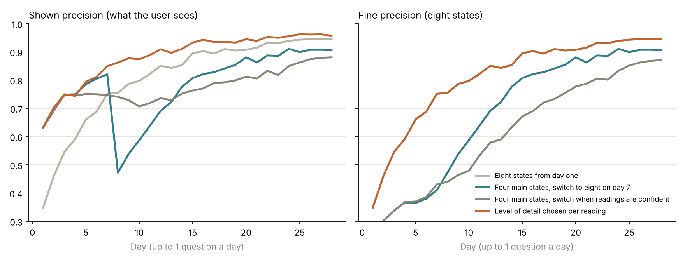

# 25 — Coarse to fine, and toward a system that reads people on its own

Author: Emanuele De Bernardis · Module: Coarse to fine · Extends: [[24-what-precise-means]], [[23-question-budget]], [[11-analogous-systems]], [[19-private-cohort-pilot]] · Experiments: E29–E30 in [[16-experiments]]

**Original contribution (E. De Bernardis):** start narrow and widen as the reading earns it. A reading is shown
at the level of detail the model is sure of (a main state such as "calm", or a finer one such as "content"),
while questions teach the fine level from day one. Later, answers from many people become archetypes, so a new
person is read well with few or no questions, as glucose monitors moved from finger-stick calibration to
factory calibration.

## 1. Four main states first, or the level of detail per reading?

People in this simulation live eight states (four main states, the quadrants, and an intermediate one between
each pair). Every reading is scored before the model learns from it; questions at ambiguous moments with closed
options; script `sim/run_progressive.py`, table `sim/results/PROGRESSIVE.md`.

- **Shown precision:** right at the level of detail shown (a main state counts as right for an intermediate
  state next to it). It is what the user experiences.
- **Fine precision:** the model's best guess among the eight states, shown or not. It is what the system knows.

| Up to 1 question a day | Shown, day 3 | Shown, day 7 | Shown, day 14 | Shown, day 28 | Fine, day 14 | Fine, day 28 | Questions by day 28 |
| --- | --- | --- | --- | --- | --- | --- | --- |
| Eight states from day one | 0.55 | 0.75 | 0.85 | 0.95 | 0.85 | 0.95 | 19.5 |
| Four main states, switch to eight on day 7 | 0.75 | 0.82 | 0.78 | 0.91 | 0.78 | 0.91 | 21.4 |
| Four main states, switch when readings are confident | 0.75 | 0.75 | 0.75 | 0.88 | 0.63 | 0.87 | 22.5 |
| **Level of detail chosen per reading** | **0.75** | **0.85** | **0.91** | **0.96** | **0.85** | **0.95** | 19.5 |

With up to 2 questions a day the per-reading approach shows 0.81 on day 3, 0.91 on day 7 and 0.98 on day 28.

- **The idea works for the user:** starting with the main states makes readings feel right from the first days
  (0.75 on day 3 instead of 0.55).
- **But switching the questions to coarse slows learning:** a coarse answer ("calm") says less than a fine one
  ("content"), so after the switch the fine level is behind (0.91 vs 0.95 on day 28) and the shown precision
  drops on the day of the switch. Waiting for confident readings is slower still.
- **The best of both:** ask fine questions from day one, but show each reading at the level the model is sure
  of: the fine state when only one fine state is plausible, otherwise the main state when only one main state is
  plausible, otherwise a question. Users see a reading that is right 85% of the time after a week, the model
  learns as fast as with eight states from day one, and the share of fine readings grows on its own (86% by day
  28). No switch day to choose. (In the right panel, its curve covers the one for eight states from day one.)

**In the product:** "you seem calm tonight" while the model is unsure between calm and content; "you seem
content tonight" once it is sure. The same rule extends to intensity and mixed states later.

## 2. From asking to reading on its own (future development)

The user's answers are the training data that Nightlet has chosen not to collect from voice and face. Over time
they let the system need fewer questions, for everyone:

1. **Phase 1, learning to read people:** the calibration questions, answers and corrections of consenting
   users (consent level 2, [[15-labels-and-consent]]) form a labelled base: signals and the state each person
   said they were in.
2. **Phase 2, archetypes:** from that base, group people by how their channels relate to what they feel: for
   example people whose face, voice and body agree; people whose words mask what their voice shows; people with
   a flat voice whose body says more; people with a serious resting face. Each archetype has its own channel
   weights and priors.
3. **Phase 3, reading on its own:** a new person gives a few days of baseline, is matched to the closest
   archetype, and starts with that archetype's weights. Questions are kept for people who do not fit any
   archetype, for new situations and for drift.

**Why it should work:** in the first simulation a consented cohort improved readings for people who never
answered a question (0.550 → 0.590, [[18-simulation]]); the engine already learns per person how much to trust
each channel ([[22-engine]]); and continuous glucose monitors followed the same path: early sensors needed
several finger-stick calibrations a day, Dexcom G6 (2018) became factory-calibrated, and per-patient calibration
is still recommended for people who deviate ([[11-analogous-systems]]).

**In code:** `engine/soulcal/detail.py` applies the level of detail per reading to any model with finer labels
(for example Nightlet's own), and `engine/soulcal/archetypes.py` is a prototype of phases 2 and 3: a label-free
signature from the first 4 days (how each channel usually looks, how often words disagree with expression),
k-means into archetypes, and a new engine that starts from its archetype's fusion head
(`python -m soulcal archetypes`, table `engine/examples/demo_out/ARCHETYPES.md`).

**First synthetic check, and an honest result.** A cohort of 24 consenting synthetic people of three types
(serious face, flat voice, masks with words) answers for 6 weeks; new people keep asking up to 1 question a day.
Accuracy in the first week, 10 seeds:

| New person | Generic start | One head pooled over the cohort | Archetype start |
| --- | --- | --- | --- |
| Serious face | 0.694 | 0.731 | 0.727 |
| Flat voice | 0.670 | 0.697 | 0.701 |
| Masks with words | 0.626 | 0.672 | 0.676 |
| Smiling face (a type not in the cohort) | 0.677 | 0.689 | 0.684 |

- **The cohort helps from the first week** (+3 to +5 points, and the gain lasts into week 4), also for a type it
  never saw: phase 1 is worth doing on its own.
- **Archetypes add nothing over one pooled head here**, because the personal baseline already removes a
  person's constant biases (serious face, flat voice); and the "fits no archetype" check matched 88% of the
  unseen type. Archetypes must earn their place on real data, against the pooled cohort, not against the
  generic model.

**Not tested on real data:** archetypes need real multimodal data from the cohort. The order of work follows:
first a pooled cohort prior, then archetypes only if they beat it.

## Check

- E29: on real users, shown and fine precision for eight states from day one vs level of detail per reading.
- E30: on the cohort, new users matched to archetypes vs one head pooled over the cohort (the control that
  matters) vs the generic model: accuracy in the first week and questions needed to reach a target, overall and
  for people who fit no archetype.
