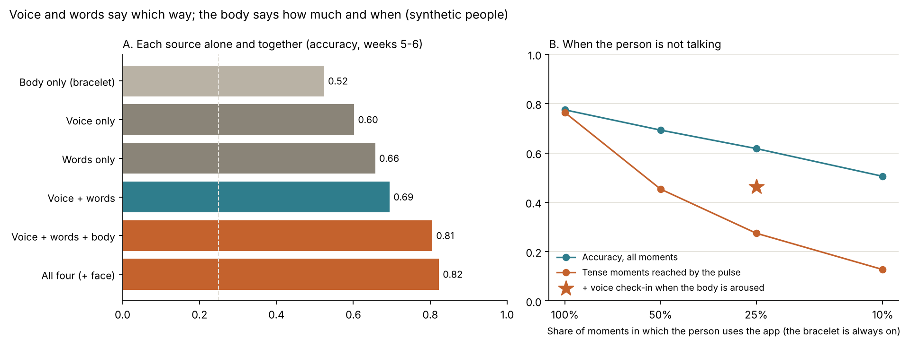

# 27 — Voice and vibration: what each is for, and how to integrate them

Author: Emanuele De Bernardis · Module: Sources and support · Extends: [[26-when-to-pulse]], [[07-fusion]], [[20-recurring-situations]], [[12-clinical-practices]] · Code: `engine/soulcal/channels_sim.py`, `engine/soulcal/haptics_sim.py`, `engine/soulcal/support.py` · Experiments: E33–E34 in [[16-experiments]]

**Original contribution (E. De Bernardis):** voice and vibration are not rivals. **The body triggers, the voice
decides, the vibration acts.** The bracelet is always on and says *how much* and *when*. Voice and words come in
short moments and say *which way*; they also teach the model to read the body-only moments. The vibration is the
action, and it is tuned to the person's own heart and breathing.

## 1. Which matters more?

They play different roles: voice and words are **inputs** that make the reading right, the vibration is the
**output** that turns a right reading into calm. The pulse can only be as good as the reading behind it, so for the
project the order is: the reading (words, voice, body), then the pulse.

**A. Each source alone and together** (synthetic people, `python -m soulcal channels`, 5 seeds × 20 people,
up to 1 question a day, scored in weeks 5–6):

| Sources | Accuracy | Speaks | Right when it speaks |
| --- | --- | --- | --- |
| Body only (bracelet) | 0.52 | 0% | – |
| Voice only | 0.60 | 24% | 0.83 |
| Words only | 0.66 | 28% | 0.88 |
| Voice + words | 0.69 | 34% | 0.89 |
| **Voice + words + body** | **0.81** | **58%** | **0.93** |
| All four (+ face) | 0.82 | 61% | 0.93 |

- The body alone cannot tell tension from excitement, so the engine never dares to speak on it.
- Voice and words alone are better, but rarely sure.
- **Together they add 12 points over voice and words, and the engine speaks almost twice as often**: they answer
  different questions. The face adds little on top.

## 2. When the person is not talking

The bracelet is worn all day; the app is opened a few times a day. **B.** The same people, with the app used in a
share of the moments and only the bracelet in the others:

| Moments with the app | Accuracy, all | With the app | Body-only moments | Tense moments reached by the pulse | Pulses at tense moments |
| --- | --- | --- | --- | --- | --- |
| 100% | 0.77 | 0.78 | – | 76% | 90% |
| 50% | 0.69 | 0.74 | **0.67** | 45% | 86% |
| 25% | 0.62 | 0.71 | 0.61 | 27% | 80% |
| 10% | 0.51 | 0.64 | 0.52 | 13% | 83% |

- **Voice moments teach the body-only moments.** When half the moments have voice, the body-only ones are read
  right 0.67 of the time, against 0.52 for a bracelet that never hears the person: the situation memory and the
  personal head carry what the answers taught. This is the link between voice and body.
- **The less the person talks, the fewer tense moments the pulse can reach** (76% → 13%), while its precision stays
  high: the rule waits rather than guessing.

**C. The body triggers, the voice decides.** At a body-only moment where the body is aroused and tension is
possible, the app invites a 5-second voice note ("How are you right now?"), at most once a day. With the app used in
25% of the moments and half of the invitations answered:

| Policy | Accuracy, body-only moments | Tense moments reached | Pulses at tense moments | Invitations per week |
| --- | --- | --- | --- | --- |
| No invitation | 0.62 | 28% | 85% | 0 |
| **Voice check-in** | 0.64 | **46%** | 88% | 1.9 |

About two invitations a week raise the tense moments reached from 28% to 46%. The invitation is itself a
moment of awareness, in the spirit of "understand yourself". In code: `SupportPolicy.decide` returns `invite`
(at most once a day, never while moving, only when the body is above the person's usual heart rate).

## 3. How others use voice

| Product | How voice is used | Lesson |
| --- | --- | --- |
| Nightlet | the user talks or types when they want; voice and face are read from those moments | voice is episodic and chosen |
| Amazon Halo (Tone) | always-on microphones on the band analysed the tone of voice; heavily criticised for privacy, microphones removed from the next model, the line discontinued in 2023 | always-on listening costs trust |
| Kintsugi | a short free-form answer to "How was your day?" (about 25 seconds) screened for depression in 14,898 adults, sensitivity 71% | a short, prompted voice sample is enough to carry signal |

**For SOUL:** voice stays episodic and consented: the user's own notes, plus at most one invitation a day when
the body suggests tension. Never always-on listening.

## 4. How others use vibration

| Product | Trigger | Pattern | Evidence |
| --- | --- | --- | --- |
| doppel | on demand, by the user | heartbeat-like, slower than the resting heart rate | single-blind lab study: smaller arousal rise and less anxiety before a speech (Azevedo et al., 2017) |
| EmotionCheck (research) | during a stress task | false slow heart-rate feedback on the wrist | 67 participants: anxiety regulated (Costa et al., 2017) |
| NightWare (FDA De Novo, Breakthrough Device) | **automatic**: heart rate and movement during sleep against a threshold learned for each person from the first nights | vibration that interrupts a nightmare without waking | prescription Apple Watch app for PTSD nightmares |
| Lief Smart Patch | **automatic**: vibrates when HRV reaches a preset level, then guides 3-minute HRV biofeedback | breathing guidance with vibration and visual cues | pilot, 14 adults: anxiety and depression scores fell; trials in substance use |
| Apollo Neuro | on demand or scheduled, by mode (calm, sleep, focus) | patterned waves | double-blind placebo-controlled crossover trials on HRV (small samples) |
| TouchPoints | on demand, push of a button | bilateral alternating (left/right) | company studies, and a triple-blind trial on cortisol listed by the company |
| Garmin | stress from HRV while still; "relax reminder" on high spikes | guided breathing, including 6-second in, 6-second out | consumer feature |

**Triggers come in two kinds:** on demand (the user decides) and automatic against a **personal** threshold
(NightWare, Lief). SOUL-Calibrate does the second with a better trigger: the reading, not the body alone, decides
(docs/26: the body alone puts half its pulses on excitement), and it keeps the first: the user can always start a
calm minute.

**Patterns come in five kinds:** heartbeat-like, breathing pacer, bilateral alternating, patterned waves, a single
tap. The two with the clearest evidence for calming are the slow heartbeat and the breathing pacer; the tap is
for the offer.

## 5. Should the vibration calibrate itself to the person? Yes

- **The heartbeat must be slower than the heart right now:** a fast heartbeat via vibration raised anxiety and heart
  rate (MacDonald et al., 2023). A fixed rate is unsafe: 60 a minute is faster than some people's heart.
- **Its effect depends on the person:** the calming effect of an artificial heartbeat depended on how well people
  perceive their own body (Keio University, 2021). So it is measured per person (held-out moments, docs/26).
- **The breathing rate has a personal optimum:** each person's resonance rate lies between about 4.5 and 7
  breaths a minute; the standard protocol tests 6.5 down to 4.5 in steps of 0.5 (Lehrer et al.; Shaffer and Meehan,
  2020).

**In code (`support.py`):** the slow heartbeat is 80% of the heart rate at that moment, never above 90% of it; the
breathing pacer starts at 6 a minute and learns the person's resonance rate from their recovery (Thompson
sampling over 4.5–7, on a separate random stream so it never changes when a pulse fires).

**Synthetic check** (`python -m soulcal haptics`; **the effects are assumptions** taken from the studies above:
slow heartbeat best near 80% of the current heart rate and arousing above it, sized by each person's body
awareness; breathing best at the person's resonance rate; 5 seeds × 200 people, 24 tense moments each):

| Rhythm | Mean effect | Last 8 moments | Heartbeat pulses faster than the heart |
| --- | --- | --- | --- |
| Slow heartbeat, fixed at 60 a minute | 0.53 | 0.53 | 3.3% |
| Slow heartbeat, 80% of the resting heart rate | 0.35 | 0.35 | 0% |
| **Slow heartbeat, 80% of the heart rate right now** | 0.72 | 0.72 | 0% |
| Breathing pacer, fixed at 6 a minute | 0.71 | 0.71 | 0% |
| **Breathing pacer, resonance rate learned** | 0.73 | **0.81** | 0% |
| Rhythm and rate learned per person | 0.73 | **0.81** | 0% |

What is robust here is the direction, not the size: tie the heartbeat to the live heart rate (a fixed rate is
sometimes faster than the heart), and learn the breathing rate, which pays off after a few weeks.

## 6. How it fits together

1. The bracelet reads the body all day against the person's baseline.
2. When the person talks or types, voice and words give the reading its direction, and every answer teaches the
   body-only moments.
3. At a body-only moment with an aroused body and possible tension: an invitation to a 5-second voice note.
4. When the reading is sure of tension: a slow pulse tied to their heart, or a breathing pacer at their rate; a
   line on screen, a calm voice only if they chose it.
5. Recovery after the pulse, against held-out moments, tunes the rhythm and its rate.

## Check

- E33: on the cohort, voice check-ins at body-only moments with an aroused body: response rate, tense moments
  reached, and whether invitations are felt as intrusive.
- E34: live-heart-rate heartbeat vs fixed rate, and learned resonance breathing vs 6 a minute: HRV and heart-rate
  recovery, and "did it help?".
