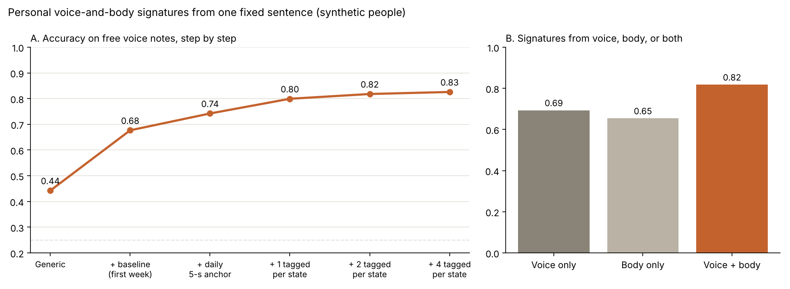

# 29 — Your voice, your body, your signature: one fixed sentence, three uses

Author: Emanuele De Bernardis · Module: Voice-and-body signatures · Builds on: [[02-enrollment]], [[03-session-anchor]], [[04-rolling-baseline]], [[28-speech-front-end]], [[27-voice-and-vibration]] · Code: `engine/soulcal/anchors.py`, `engine/soulcal/anchors_sim.py` · Experiments: E35–E36 in [[16-experiments]]

**Original contribution (E. De Bernardis):** the body already has a personal baseline; the voice gets one too,
and then one more step: the same short sentence, read when the person feels a clear state and says what it is,
becomes **their own signature** of that state, voice and body together. Same words, so only the voice and the
body differ. The system learns the person; the person learns themselves.

## 1. One fixed sentence, three moments

| Moment | What the person does | What the system learns |
| --- | --- | --- |
| **Enrollment** (first week, about 15 seconds a day) | reads the sentence in a normal tone, three times | their usual voice and body: every later reading is measured against them, not against other people |
| **Daily anchor** (5 seconds, evening) | reads it once, whatever the mood | today's microphone, room and day, removed from the evening's voice notes |
| **Tagged reading** (when they want, a few times per state) | "I'm angry right now": reads the sentence and says how they feel | the difference between this state and their calm, in pitch, energy, speech rate, pauses, voice quality, heart rate, HRV and skin temperature: **their signature** |

Enrollment and the daily anchor were designed in [[02-enrollment]] and [[03-session-anchor]]; until now they were
only on paper. The tagged reading is new: a labelled, controlled sample of the person in a state, where the words
cannot leak into the reading (the lexical leakage of [[03-session-anchor]]).

## 2. What the signature adds (synthetic check)

`python -m soulcal anchors` (5 seeds × 40 people; 6 prosodic features and 3 body signals; who the person is
weighs most, then today's microphone and room, then the state, expressed in each person's own way; read sentences
carry less emotion than free speech, after Koch et al.; tagged readings in days 8–21; scored on free voice notes
in days 22–42; 4 states, chance 25%):

| Reference | Accuracy on free voice notes |
| --- | --- |
| Generic (no personal reference) | 0.44 |
| + voice-and-body baseline (enrollment) | 0.68 |
| + daily 5-second anchor | 0.74 |
| + 1 tagged reading per state | 0.80 |
| + 2 tagged readings per state | **0.82** |
| + 4 tagged readings per state | 0.83 |
| Voice only, + 2 tagged readings | 0.69 |
| Body only, + 2 tagged readings | 0.65 |

- **Each step adds:** the baseline removes who the person is (+24 points), the anchor removes today's microphone
  and room (+6), and **one or two tagged readings per state add another 6–8**, because they capture how *this*
  person shows tension or sadness, which the population direction misses.
- **Two tagged readings per state are enough:** about eight sentences in the first weeks.
- **Voice and body together beat either alone** (0.82 vs 0.69 and 0.65): the signature is multimodal by design.
- These are a model of the problem, not a measurement; E35 measures it on people.

## 3. Voluntary: the person chooses how fast

Everything here is optional, and the person picks the speed. Each mode asks for the minimum that reached its level
in the checks (questions: [[23-question-budget]]; sentences: below). After the first week:

| Mode | Questions | Evening anchor (5 s) | Tagged sentence ("read it and tell me how you feel") | Time a week | Accuracy, week 3 / week 6 |
| --- | --- | --- | --- | --- | --- |
| Light | one every 2 days | every evening | 1 a week | about 1 minute | 0.72 / 0.74 |
| Standard | 1 a day | every evening | 3 a week | about 1.5 minutes | 0.75 / 0.82 |
| Fast | 2 a day | every evening | 1 a day (2 readings a day in week 1) | about 2.5 minutes | 0.82 / 0.86 |

(Accuracy of the signature on free voice notes, synthetic; times estimated at 5 s an anchor, 10 s a sentence,
3 s a question; in code: `anchors.MODES`, `seconds_per_week`, `offer_tagged_today`.)

- **The cheapest feedback with the biggest effect is the 5-second evening anchor:** reading it only three evenings a
  week costs 7–12 points against reading it every evening (0.65–0.70 vs 0.73–0.82).
- **Tagged sentences make the difference between modes:** the fast mode collects two readings of every state in
  about three weeks; the light mode stays near the anchor-only level.
- The sentence is read in the state the person says they are in, never acted: the label is theirs.

## 4. The person learns too

The signature is something the app can show back: "When you're tense your voice gets faster and higher, with
more pauses, and your heart rate rises by about 12" (`SignatureModel.difference`). That is the "understand
yourself" of Nightlet in the most literal form: the person reads the same sentence when angry and when calm, and
sees and hears the difference. Naming a feeling, and noticing one's own body, are themselves ways of regulating
it (affect labeling, [[05-active-questions]]; HRV biofeedback, [[12-clinical-practices]]). Whether seeing one's
signature improves self-awareness is a question for E36, not a claim.

This is learning by the person, not reinforcement learning in the technical sense: the person chooses when to
read, the system shows the difference, and both get better at noticing it.

## 5. How it fits in the engine

- `SignatureModel` turns prosodic features and body signals into a probability for each state, which feeds the
  engine's **voice** channel ([[22-engine]]); the engine keeps fusing it with words, face and situation memory.
- When the signature already uses the body signals, the engine's own body channel should be left out for that
  reading, so the body is not counted twice.
- A strong open speech-emotion model ([[28-speech-front-end]]) and the signature combine: the model's embedding
  or scores can be the features, and the signature makes them personal.
- **Blood pressure:** if the bracelet measures it, it is one more body feature in the signature; the method does
  not change. It is not assumed here.
- Privacy: only features, never raw audio, leave the moment of recording ([[09-privacy-and-regulation]]).

## Check

- E35: on the cohort, accuracy on free voice notes with baseline, + daily anchor, + 1/2/4 tagged readings per
  state; and how many people actually make tagged readings.
- E36: does seeing one's own signature improve emotional awareness (self-report and interoceptive measures) after
  four weeks, compared with not seeing it?
