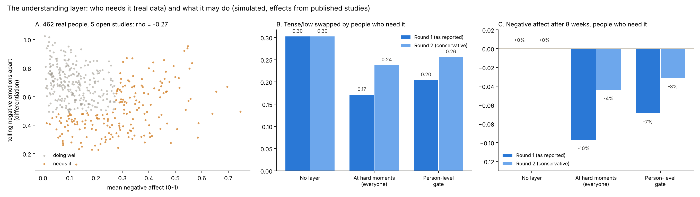
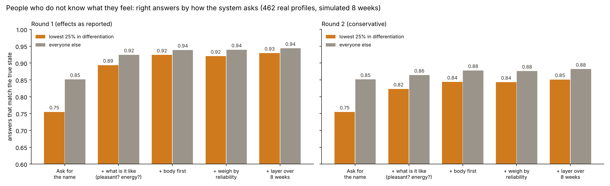

# 30 · The understanding layer

**Where it comes from.** In the conversation with Nightlet's founder (26 November 2026) the reflective part of
SOUL, including astrology, was framed differently from how this repository first treated it: not as a signal to
verify, but as a way in. Like a medicine hidden in food, a symbolic language can lead a young person to look at
their own feelings, which matters more as people deal with each other less and with AI more. This document turns
that idea into a measurable layer on top of the reading.

**What it adds.** The reading ([[01-architecture]], [[29-voice-signatures]]) says which state the person is
probably in. The understanding layer helps the person *understand* that state: put it into words, notice it in the
body, see their own patterns, and, when it lasts, talk to someone.

## 1. Who needs it: real data

Five open experience-sampling studies (Bringmann et al. 2013 and 2016, Fisher et al. 2017, Fried et al. 2021,
Rowland & Wenzel 2020; archive jmbh/EmotionTimeSeries) give 462 people with at least 30 prompts each, two of
them clinical samples. For each person: mean and spread of negative affect, its inertia, and negative-emotion
differentiation (1 minus the mean correlation between their negative emotions: how well they tell anger, worry and
sadness apart). Only these person-level summaries are kept (`engine/soulcal/data/esm_profiles.json`,
`sim/esm/extract_profiles.py`).

- **People with more negative affect tell their negative emotions apart less well** (Spearman rho = -0.27,
  p < 1e-8). The people who feel worse are also the people who find it harder to say what they feel.
- 42% of people are in the top quarter of negative affect or the bottom quarter of differentiation
  ("needs it" below); the two overlap little (8%), so they are two different needs.

## 2. What the layer does

Four ingredients with published evidence, each mapped to something the engine already has:

| Ingredient | Evidence | In SOUL-Calibrate |
| --- | --- | --- |
| Naming the feeling (affect labeling) | lowers amygdala response and distress (Lieberman et al. 2007) | the engine's questions; a finer word from coarse-to-fine ([[25-coarse-to-fine-and-archetypes]]) |
| Emotional granularity | grows with repeated momentary reporting (Hoemann, Barrett & Quigley 2021) | answers over weeks; measured by `granularity_index` |
| Interoception, the body as a mirror | heartbeat-synchronised wrist vibration reduced emotional disturbance during fear clips (Kim, ..., Maes, MIT Media Lab, IMWUT 2025) | the voice-and-body signature shown back; the bracelet's heartbeat pulse ([[26-when-to-pulse]]) |
| Reflection prompted by context | LLM prompts built from phone sensing: +7% positive affect, -11% negative, -6% loneliness in 8 weeks, n = 20 (MindScape, IMWUT 2024); expressive writing: small but durable effect, g = -0.12 | questions built from situation memory; a weekly story of the person's measured patterns |

**A lens, not a forecast.** A prompt can be framed by a symbolic lens the person chooses (weather, seasons,
astrology). The lens frames the question; the content always comes from the person's own data, never predicts,
never changes the reading. Generic descriptions feel personal to almost everyone (the Barnum effect), which is why
the lens works and also why it must carry real, personal content.

**Dosed by need, without labelling people.** `understanding.prompt` speaks only at hard or ambiguous moments, plus
one weekly reflection for everyone. `understanding.NeedGate` watches the share of negative readings and how often
answers swap two negative states that the reading separates confidently. It decides one thing only: when distress
lasts (10 days in a row with mostly negative readings) the prompt points to a person, never to more time in the app.

## 3. Two rounds of simulation

`python -m soulcal understanding` (`understanding_sim.py`): each simulated person is one of the 462 real profiles
(their negative and positive affect follow their own mean, spread and inertia); they swap tense and low with a
probability set by their real differentiation; the reading is a personal model learning from their answers; one
question a day at most; 8 weeks, 3 seeds. The layer's effects are assumptions: round 1 as reported in the studies
above, round 2 conservative (40% of the granularity gain, half the relief, none for people doing well as in the
ECoWeB trials, no extra answers from the lens).

| People who need it (round 1 / round 2) | No layer | At hard moments, for everyone | Person-level gate |
| --- | --- | --- | --- |
| Tense and low swapped (start 0.30) | 0.30 / 0.30 | **0.17 / 0.24** | 0.20 / 0.26 |
| Negative affect after 8 weeks | 0% / 0% | **-10% / -4%** | -7% / -3% |
| Prompts a week | 0 | 4.2 | 3.4 |

| People doing well | No layer | At hard moments, for everyone | Person-level gate |
| --- | --- | --- | --- |
| Prompts a week | 0 | 1.3 | 1.4 |
| Negative affect after 8 weeks | 0% | -4% / 0% | -1% / 0% |

- **The layer doses itself.** Because it speaks at hard moments, people who need it get about 4 prompts a week
  and people doing well about 1 (the weekly reflection). A person-level gate does worse: it starts after two
  weeks, misses 18% of people who need it and switches on for a third of people doing well.
- **The step towards a person is precise:** 12-16% of people who need it reach 10 days in a row of mostly negative
  readings (fewer when the layer has already helped), about 0.1% of people doing well.
- **The reading barely changes** (0.68 to 0.69): better labels help the person more than the model here.
- **Round 2 still helps people who need it** (confusion -21%, negative affect -4%) and does nothing, good or bad,
  for people doing well: the layer is for those who need it and stays out of the way for the others.

## 4. A person who does not know what they feel

The engine learns from answers, so it needs the right answers. Someone who understands themselves gives them; someone
who does not (low emotional awareness, alexithymia at the far end) answers "tense" when they are low, or the
opposite. In the real data a quarter of people have very low differentiation of negative feelings, and in the
simulation their answers are right 75% of the time against 85% for the others.

What the research says can be learned:

- **Emotional awareness improves with training.** A 2026 meta-analysis of 59 studies (Mazza et al., J. Affective
  Disorders) finds interventions reduce alexithymia (g = −0.52), the integrative ones most; mindfulness alone lowers
  the TAS-20 by about 5 points (Norman et al., 2019).
- **Emotion knowledge raises differentiation.** A short emotion-knowledge intervention increased negative emotion
  differentiation (Vedernikova, Kuppens & Erbas, 2021); online emotion-word training had partial effects (2024).
- **The body comes first.** Emotions have consistent, culturally shared bodily maps (Nummenmaa et al., 2014, PNAS,
  n = 701); interoceptive awareness strongly predicts alexithymia, and nine months of training raised heartbeat
  perception while alexithymia fell (Bornemann & Singer, 2017). Skills-based body-awareness training works best.

What the system does with it (`soulcal/understanding.py`):

- **Ask what it is like, not its name.** Pleasant or unpleasant first (almost everyone gets valence right), then a
  lot of energy or little, with "not sure" always allowed. `compose()` turns the two easy answers into the state;
  "not sure" keeps both options open, so nothing wrong is learned.
- **Show the body first.** `body_first()` says what the bracelet and the voice show before the question ("your heart
  rate is higher than usual"), so the answer starts from a signal, and then "where do you feel it?" (Nummenmaa).
- **Weigh each answer by how much it can be trusted.** `AnswerReliability` counts how often this person agrees
  with confident readings (a one-person version of Dawid & Skene, 1979). An answer that contradicts a confident
  reading weighs less when the person often swaps states, and the weight rises as they learn.
- **Learn, over weeks.** The understanding layer (section 2) adds the finer words, so the questions get easier.

Simulation on the 462 real profiles, people in the lowest quarter of differentiation ("hard") against the others,
3 seeds, `python -m soulcal understanding`:

| How the system asks and learns | Answers right, round 1 (hard / others) | Round 2 | Reading right, weeks 7-8, round 1 (hard / others) |
| --- | --- | --- | --- |
| Ask for the name (today) | 0.75 / 0.85 | 0.75 / 0.85 | 0.66 / 0.68 |
| + ask what it is like | 0.89 / 0.92 | 0.82 / 0.86 | 0.70 / 0.70 |
| + body first | 0.92 / 0.94 | 0.84 / 0.88 | 0.70 / 0.70 |
| + weigh answers by reliability | 0.92 / 0.94 | 0.84 / 0.88 | 0.71 / 0.71 |
| + understanding layer over 8 weeks | 0.93 / 0.94 | 0.85 / 0.88 | 0.70 / 0.70 |

Round 1 uses effects as reported (valence error 4%, energy errors halved, body first removes 40% of what is left);
round 2 is conservative (8%, a quarter less, 20%). "Not sure" is used for 3-9% of questions.

What it shows: asking what it is like closes most of the gap; the right answers rise from 0.75 to 0.89 (0.82 in
round 2) for the people who find it hardest, and the gap to the others falls from 10 points to 1-3. The reading
itself gains about 4-5 points for them and ends level with the others: the reading is only as good as the answers,
and the answers stop being the weak link. The weighing adds little on top once the questions are easy; it matters
for people who keep swapping. These are simulated effects on real profiles, to be measured in E41-E43.

## 5. What it is not

Not therapy and not a diagnosis. Adolescents question chatbot answers less than adults and an AI relationship can
displace real ones (APA health advisory, 2025); heavier daily chatbot use went with more loneliness and emotional
dependence in an MIT Media Lab and OpenAI study (2025). Hence: short prompts, a weekly cap, no companion persona, and
the bridge to people. Emotion inference in schools and workplaces is prohibited under the EU AI Act, Article 5(1)(f),
except for medical or safety reasons; elsewhere it is high-risk ([[09-privacy-and-regulation]]).

## 6. Experiments

- **E37 · Lens vs neutral:** the same prompts with and without a symbolic lens, micro-randomised: answer rate,
  retention, and whether the person names their state more finely. Proves it wrong: no difference, or the lens
  lowers the quality of answers.
- **E38 · Granularity grows:** `granularity_index` and an emotion-differentiation score rise over 8 weeks in people
  who start low. Proves it wrong: no change against a self-monitoring-only arm.
- **E39 · Body mirror:** heartbeat-synchronised pulse vs a delayed (sham) pulse during hard moments, as in the MIT
  design: self-reported disturbance and recovery. Proves it wrong: no difference from sham.
- **E40 · Towards people:** after a bridge prompt, does the person report contact with someone within 48 hours?
  Does daily time in the app stay flat? Proves it wrong: time in the app rises and contact does not.
- **E41 · What it is like vs its name:** micro-randomised between the two ways of asking, in people starting low on
  differentiation: agreement with the voice-and-body reading and with a later recall. Proves it wrong: no difference.
- **E42 · Body first:** the signal shown before the question or not: answer agreement and interoceptive accuracy
  (heartbeat counting against the bracelet's heart rate) after four weeks. Proves it wrong: no difference from sham.
- **E43 · Awareness over time:** TAS-20 and emotion differentiation at 0, 8 and 16 weeks in people starting high on
  alexithymia. Proves it wrong: no change against self-monitoring only.

## Check

`python -m pytest engine/tests -q` includes the need gate, the prompts, the scaffolded questions, answer reliability and the simulations on the open data.
